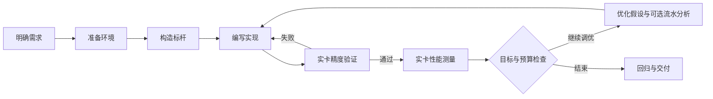

<div align="center">

# Operator Harness

**从算子需求，到可验证、可复现的昇腾内核。**

面向华为昇腾 NPU 的 AI 算子开发工作流。<br>
以 TileLang 为起点，连接需求分析、算子编写、实卡验证与性能调优。

[工作流程](#工作流程) · [目标能力](#目标能力) · [使用方式](#使用方式) · [路线图](docs/ROADMAP.md) · [开发文档](#开发文档)

</div>

> **项目状态：早期建设中。** 已提供面向 Codex 的项目初始化、已有项目接入和任务接续 skills，包含实验记录与子 agent 交接流程。算子执行适配、实卡评测、仿真 MCP 和 npm 分发仍在建设计划中；下文“目标能力”描述建设方向，具体支持范围以逐项验收结果为准。

## 什么是 Operator Harness

Operator Harness 旨在把算子开发中的需求、知识、工具和验证结果组织成一个 agent 可以持续执行的流程。

用户描述算子的功能、输入范围和性能目标，harness 引导 agent 明确验收条件、检查环境、建立标杆、编写实现，并根据真实运行结果反复改进。最终交付包括算子代码、正确性结果、性能对比和复现说明。

首批仅接入 [tile-ai/tilelang](https://github.com/tile-ai/tilelang)。语言适配保留扩展空间，AscendC 等独立语言入口在后续按需求评估。

## 为什么做这个项目

算子开发需要同时处理数学语义、编译器能力、硬件约束和测量方法。一次代码生成之后，往往还有大量工作：确认动态 shape 的含义、处理非对齐输入、定位精度差异、准备远程环境，以及判断性能变化是否可信。

我们希望把这些工作沉淀为可重复的流程：

- **需求有边界。** 在实现前明确 shape、dtype、布局、误差、外部约束和验收目标。
- **执行有反馈。** 编译错误、精度反例和性能样本进入下一轮修改。
- **结果有依据。** 每份结果关联具体候选、输入、工具链和执行环境。
- **迭代可接续。** 保存当前进度、失败原因和最佳已验证候选，让后续会话能够继续工作。

## 工作流程

每个算子围绕同一条主路径推进：



1. **明确需求**：确定功能语义、动态 shape 行为、case 范围、数值要求和外部约束。
2. **准备环境**：确认芯片、工具链与执行方式，完成最小编译和运行检查，记录环境附加限制。
3. **构造标杆**：分别建立正确性参考和性能基线，固定输入、误差容限与测量协议。
4. **编写与验证**：生成 TileLang 初版，通过实卡比较发现并修复问题。
5. **迭代调优**：提出优化假设，必要时分析流水，修改后重新验证精度和性能。
6. **回归与交付**：保留最佳已验证候选，汇总全部必选 case；预算耗尽时明确报告尚未达成的目标。

流水分析是可选节点，可以使用仿真或实卡采集辅助定位瓶颈。性能收益最终通过约定的实卡测量验证。

## 目标能力

| 能力 | 目标体验 |
| --- | --- |
| TileLang 算子编写 | 按当前上游文档、示例和任务约束生成与修改算子 |
| 实卡精度验证 | 独立参考、边界 case、全部输出比较和可复现失败样本 |
| 实卡性能验证 | 固定基线、预热与重复采样、逐 case 对比，保留回退结果 |
| 可选流水分析 | 获取仿真或实卡 trace，形成有证据的优化假设 |
| 多环境执行 | 在本地或远程的 host/docker 环境完成任务并回收结果 |
| 实验记录与恢复 | 保存候选、日志、环境身份、阶段状态和验证证据 |
| 项目接入与分发 | 通过 CLI 将所需能力安装到用户已有的算子项目 |

### 执行环境

仿真与实卡测试都以以下四种环境组合为目标，逐项验证兼容性：

| 执行位置 | 环境 | 仿真 | 实卡精度 / 性能 |
| --- | --- | --- | --- |
| 本地 | host | 规划中 | 规划中 |
| 本地 | docker | 规划中 | 规划中 |
| 远程 | host | 规划中 | 规划中 |
| 远程 | docker | 规划中 | 规划中 |

每个组合还需明确芯片和工具链版本。编译位置与运行位置分别记录，支持远程执行不代表客户端可以省略全部编译依赖。

### Skills、MCP 与 hooks

| 机制 | 在项目中的职责 |
| --- | --- |
| **Skills** | 提供算子开发、API 检索、调试和优化方法，按任务需要加载 |
| **MCP** | 接入外部执行与分析能力；优先评估封装 simulator 的仿真任务接口 |
| **Hooks** | 在任务和工具事件发生时记录信息、执行检查、更新状态 |
| **工作流与评测程序** | 根据实际证据推进阶段，判断精度、性能和任务完成情况 |

执行能力优先评估复用现有 simulator 与基于 DeepJIT 的 Onboard，技能按可移植性选择性迁移。详见 [现有资产复用计划](docs/REUSE_PLAN.md)。

## 使用方式

### 当前可用：Codex 项目初始化与接续

本仓库已通过 `.agents/skills/` 接入三项技能，在 Codex 中选择或输入：

```text
$harness-new-project 为我的 TileLang 算子项目明确需求并建立路线图。
$harness-onboard 梳理这个已有项目的代码、文档和验证方式，建立后续计划。
$harness-resume 先恢复目标、当前性能和优化历史，再继续下一步分析或调优。
```

`harness-new-project` 用于新项目的需求澄清和规划；`harness-onboard` 用于已有项目接入，这里的 onboard 不执行 NPU 上板。CLI/IDE 也可通过 `/skills` 选择技能；本项目没有注册 `/harness-*` 顶层 slash commands。若技能尚未出现在宿主中，重启会话后再检查。发现与调用方式见 [Codex 技能文档](https://learn.chatgpt.com/docs/build-skills)。

两个入口共用连续追问流程：沿着回答深入，用具体场景澄清歧义，理解充分后复述并进入规划，或按用户选择继续探索。已有项目先吸收代码和文档，只追问未知项与实际冲突；明确的“直接生成”指令不再重复确认。未结束的讨论暂存在 `.workspace/drafts/`，已有阻塞问题在下次调用时继续澄清。

要在其他项目使用，从本仓库根目录执行（安装脚本使用 Python 3）：

```bash
python3 scripts/install_codex_skills.py --project-dir /path/to/operator-project
```

Git 项目安装到当前 worktree 根；非 Git 项目安装到指定目录。安装器复制三项技能到 `.agents/skills/`，向 `AGENTS.md` 追加接续指引，并在 `.gitignore` 中加入 `.workspace/`，保留已有内容。重复安装不会重复追加；只比较随包提供的技能文件，用户额外添加的文件保留不动。随包文件存在不同内容时报告冲突。升级与卸载另按路线图建设。

Agent 直接维护 `.workspace/` 中的 `PROJECT.md`、`REQUIREMENTS.md`、`ROADMAP.md` 和 `STATE.md`，接入已有项目时补充 `codebase/MAP.md`。这些都是可以直接编辑的 Markdown，按项目进展逐步建立；未决问题和下一步留在状态记录中，草稿与研究材料按需保存。

后续工作通过 `harness-resume` 接续：`STATE.md` 保存当前候选、最佳已验证候选、性能概况与下一步；`EXPERIMENTS.md` 记录成功、失败和无收益的尝试；`runs/<编号>/` 保存对应代码、详细结果与日志。新的 agent 先读摘要，再按需要打开相关实验。

较长的调查、分析或实验可由独立上下文的子 agent 执行，主 agent 汇总结果并更新共享状态；没有委派工具时使用同样的记录直接执行。使用新机器或 worktree 时，需要带上被 Git 忽略的 `.workspace/` 记录和相关产物。具体交接方法见 [工作记录与交接](assets/skills/harness-resume/references/working-context.md)。

### 规划中：npm 分发与执行闭环

计划通过 npm 分发 CLI，让用户在自己的算子项目中初始化 harness，再通过所选 coding agent 开始工作。以下为接口示意，包名尚未确定，不能直接执行：

```text
npx <package>@<version> init
npx <package>@<version> doctor
```

`init` 计划接入所需 skills、指令与工具配置；`doctor` 检查接入状态和执行环境。升级、卸载及已有配置的合并也属于发布计划。

初始化后的目标交互是一项明确的算子任务，例如：

> 使用 TileLang 为目标昇腾设备实现这个算子。输入规格、参考实现和业务 case 已提供；请先检查需求与环境，建立精度和性能标杆，再实现并调优，最后给出逐 case 结果和复现说明。

首个 agent 宿主已确定为 Codex。可从 [需求与工作流](docs/REQUIREMENTS.md) 了解任务需要提供的信息。

## 如何判断完成

目标工作流以可检查的证据作为完成条件：

- 编译成功、实卡精度通过和性能达标分别记录。
- 候选代码、输入范围或环境变化后，重新取得受影响的验证结果。
- 正确性参考与性能基线分别管理，调优保留固定的比较条件。
- 仿真 cycle、设备任务时长和端到端延迟分别报告。
- 超时、缺少设备数据和残缺采集保留诊断记录，不记为成功。
- 保留全部必选 case 的结果，以及性能回退、未达标和未验证项。

这些规则将进入工作流和评测实现，并由 skills 指导 agent 正确使用。

## 路线图

| 阶段 | 交付目标 | 当前状态 |
| --- | --- | --- |
| M0–M1 | 项目定位、任务需求、环境与验收契约 | 文档与资产初查已建立，任务契约待冻结 |
| M2 | 首个 TileLang 实卡开发与验证闭环 | 待开始 |
| M3 | CLI 初始化和一个 agent 宿主接入 | Codex 初始化 skills 与源码安装器已实现；npm CLI 待建设 |
| M4 | 执行矩阵、仿真 MCP、可选流水分析与恢复 | 待开始 |
| M5 | 升级、卸载和独立发布 | 待开始 |
| M6 | 更多算子、宿主与按需语言扩展 | 后续演进 |

阶段验收条件与待决事项见 [完整路线图](docs/ROADMAP.md)。

## 开发文档

| 文档 | 内容 |
| --- | --- |
| [开发路线图](docs/ROADMAP.md) | 阶段安排、验收条件和待决事项 |
| [需求与工作流](docs/REQUIREMENTS.md) | 算子需求清单、标杆构造、阶段检查和执行矩阵 |
| [现有资产复用计划](docs/REUSE_PLAN.md) | Skills、simulator、Onboard 与 GSD 的检查结果和迁移方向 |

## 参与开发

当前开发仅限 `harness` 分支及其派生分支。开发文档统一放在 `docs/`，随阶段推进补充设计与实现依据。

对外交付的技能维护在 `assets/skills/`；本仓库的 `.agents/skills/` 通过相对软链接使用同一份内容。

`.workspace/` 用于中间产物、临时实验、日志和本地备份，已加入 `.gitignore`。需要长期复现的任务定义、最终代码和必要报告进入版本管理。

## 设计参考

项目参考 [GSD Core](https://github.com/open-gsd/gsd-core) 的阶段化工作方式与持久状态组织，围绕算子需求、标杆、实卡验证和调优迭代建立自己的完成条件。首批两个入口已借鉴其流程并独立实现，不依赖 GSD runtime；[固定版本来源与许可](assets/skills/harness-new-project/references/provenance.md) 随技能保留。后续执行流是否整体引入 GSD 仍待评估。
