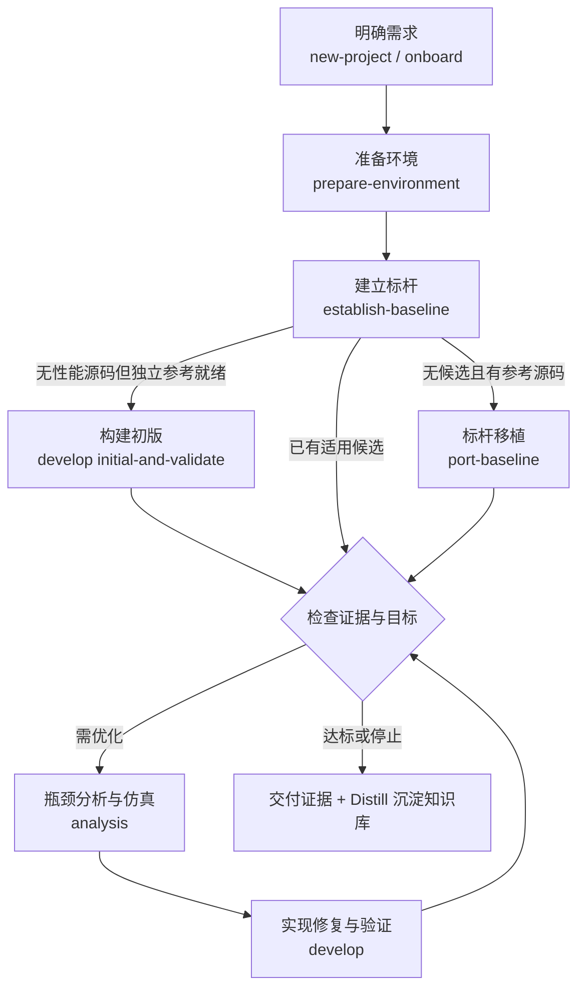

<div align="center">

# Operator Harness

**从算子需求，到可验证、可复现的昇腾 TileLang 内核。**

面向华为昇腾 NPU 的 AI 算子开发工作流与知识库。<br>
以 TileLang 为起点，连接需求澄清、标杆建立、实卡验证、仿真分析与微架构经验沉淀。

[快速上手](#快速上手) · [工作流程](#工作流程) · [使用方式](#使用方式) · [算子知识库](#算子知识库) · [路线图](docs/ROADMAP.md) · [开发文档](#开发文档)

</div>

> **项目状态：核心工作流与三层知识库已可用，通用评测/执行接口与工作流分级严格度持续演进中。** 已提供跨平台 CLI（`tilelang-harness`，支持 Codex / Antigravity / Claude Code / 通用 `.agent` 的 Global/Local 安装、体检、升级、回滚与卸载）、项目管理、五节点工作流、`status/next/automatic` 推进入口、Roofline/MFU 工具、Ascend950 仿真 trace 增强脚本与三层可扩展算子知识库（`tilelang-ascend-knowledge`）。当前能力边界见 [能力表](docs/capabilities.md)，后续规划见 [路线图](docs/ROADMAP.md)。

## 什么是 Operator Harness

Operator Harness 把昇腾算子开发中的**需求契约、硬件验证纪律、诊断工具与微架构优化经验**组织成 Agent 可持续执行与复用的工程体系：

- **需求与验收有边界**：编码前明确 shape、动态性、dtype、布局、误差容限、计时口径与交付范围。
- **验证与诊断有工具**：内置双引擎 Roofline/MFU/BWU 计算、Ascend950 仿真流水增强与 `msprof` 离线解析，严守 `NaN` 哨兵、独立参考、同批 AB/BA 配对与频率归一化等物理评测铁律。
- **实战经验可持续沉淀**：通过三层可扩展知识库（通用范式与铁律 → 微架构模式/反例卡 → 算子族 Playbook）按需检索，并在算子交付后持续反哺新项目。
- **迭代可恢复、多项目隔离**：通过独立源码 worktree 与落盘产物支持跨会话接续和并行开发。

首批语言面向用户指定版本的 [tile-ai/tilelang](https://github.com/tile-ai/tilelang)（Ascend 后端），已支持 Codex、Antigravity、Claude Code 与通用 `.agent` 四类宿主；其他语言与宿主保留后续扩展空间。

---

## 快速上手

### 1. 安装（支持 Windows / macOS / Linux，要求 Node.js >= 18）

直接通过 `npx` 从本仓库 `harness` 分支启动交互式安装向导（推荐选择 **Global** 全局安装一次，之后在任意算子仓库均可直接使用）：

```bash
# 启动交互式向导（先选 Global / Local，再勾选宿主）
npx github:tile-ai/tilelang-mlir-ascend#harness
```

> 若所用 npm 版本禁用了 Git 来源并提示 `EALLOWGIT`，加上 `--allow-git=all` 即可：
> `npx --allow-git=all github:tile-ai/tilelang-mlir-ascend#harness`

也支持非交互式命令（适合脚本、CI 或指定单个宿主）：

```bash
# 全局安装一次（四个宿主路径互不重叠，可一次全选）
npx github:tile-ai/tilelang-mlir-ascend#harness init --global --host codex,claude-code

# 仅安装到指定项目目录
npx github:tile-ai/tilelang-mlir-ascend#harness init --local --dir /path/to/repo --host codex

# 检查安装完整性与本机 Node / Python 运行时
npx github:tile-ai/tilelang-mlir-ascend#harness doctor
```

| `--host` | 别名 | Global（`--global`，推荐） | Local（`--local`） |
| --- | --- | --- | --- |
| `codex`（默认） | - | `~/.codex/skills/` + `~/.codex/AGENTS.md` | `.agents/skills/` + `AGENTS.md` |
| `antigravity` | `agy` | `~/.gemini/config/skills/` + `~/.gemini/GEMINI.md` | `.agents/skills/` + `AGENTS.md` |
| `claude-code` | `claude` | `~/.claude/skills/` + `~/.claude/CLAUDE.md` | `.claude/skills/` + `CLAUDE.md` |
| `agent` | `.agent`, `generic` | `~/.agent/skills/` + `~/.agent/AGENTS.md` | `.agent/skills/` + `AGENTS.md` |

安装器只负责复制受管技能、追加宿主指令区块并记录 `manifest.json`，**不会提前绑定或创建 `.workspace/`，也不会静默修改共享 `.gitignore`**。重复安装具有幂等性；检测到冲突或用户本地修改时会提前拒绝并保留原文件。升级、中断恢复、回滚与卸载命令见 [安装与升级说明](docs/installation-upgrades.md)。若直接在本仓库内开发，`.agents/skills/` 已通过软链接指向 `assets/skills/`，无需再运行安装器。

### 2. 开启第一个算子任务

在目标算子仓库打开你的 coding agent（若刚安装完未看到新技能，先重启会话），按场景选择入口（各节点会在当前仓库下独立管理 `.workspace/`；首次在 Git 仓库创建 `.workspace/` 时，推荐执行 `echo ".workspace/" >> .git/info/exclude` 做本地忽略，避免污染团队共享 `.gitignore`）：

- **从零开发新算子**：
  ```text
  $harness-new-project 我想用 TileLang 在昇腾上实现 <算子名>，输入规格和目标性能如下：...
  ```
- **把已有算子仓库接入 Harness 继续优化**：
  ```text
  $harness-onboard 梳理当前仓库里的算子代码与测试入口，建立后续优化计划。
  ```

### 3. 日常推进与接续

初始化完成后，按下面的常用入口日常推进与接续即可：

| 你想做什么 | 调用方式 | 行为 |
| --- | --- | --- |
| 只看当前进展与推荐动作 | `$harness-status` | 只读汇报项目状态、最新候选、阻塞项与下一步建议，不修改文件 |
| 稳妥推进一个节点 | `$harness-next` | 直接执行当前推荐的一个节点并更新记录，完成后返回 |
| 在预算内连续自动迭代 | `$harness-automatic` | 在既有目标与步数/预算上限内连续协调 `analysis → develop` 循环 |
| 新会话接续或人工切入 | `$harness-resume` | 恢复 `STATE.md`、当前 TASK 与优化历史后继续工作 |

---

## 工作流程

每个算子围绕一条统一主路径推进，**精度通过是进入性能计时与优化迭代的硬前提**：



1. **明确需求**：确定功能语义、动态 shape 含义、case 范围、误差容限与外部约束。
2. **准备环境**：确定 Python、TileLang、torch/torch_npu 与 CANN，优先复用已有环境，记录共享描述（`.workspace/environments/`）与项目绑定。
3. **建立标杆**：分别固定独立正确性参考与性能基线，固定输入、容限与测量协议；开局先做 Roofline 与理论天花板摸底。
4. **初版实现**：有参考源码时由 `port-baseline` 忠实映射参考策略并替代 AICPU 等已知缺口；无性能源码时由 `develop` 的 `initial-and-validate` 构建初版。
5. **迭代调优（`analysis → develop → analysis`）**：优先用离线建模与小分片仿真证伪低效方案，再上真机做同批 AB/BA 配对验证与按需 `msprof` 采集。
6. **交付与经验沉淀**：汇总全必选 case、退化项与复现命令；阶段交付后将可跨算子复用的微架构模式与反例提炼进知识库。

---

## 使用方式

本仓库在 `.agents/skills/`（源文件在 `assets/skills/`）中按职责组织了三组技能，在 Codex 中通过 `$<skill-name>` 或 `/skills` 调用：

### 1. 项目生命周期与推进模式

| Skill | 职责 |
| --- | --- |
| `$harness-new-project` | 新算子项目的需求澄清、契约固定、目录初始化与独立 worktree 创建 |
| `$harness-onboard` | 接入已有算子仓库，梳理源码/文档并建立后续优化计划（不执行 NPU 上板） |
| `$harness-status` | 只读查看单个或全部项目进展、候选、在途状态与推荐下一步 |
| `$harness-next` | 直接推进当前推荐的一个节点并更新状态 |
| `$harness-automatic` | 在目标与预算内连续协调推进（默认每批最多 8 步，可随时暂停恢复） |
| `$harness-resume` | 跨会话恢复上下文、交接检查点与任务状态 |
| `$harness-archive-project` / `$harness-restore-project` | 冻结/归档项目现场，以及后续检查恢复 |

### 2. 五个核心执行节点

| Skill | 职责 |
| --- | --- |
| `$harness-prepare-environment` | 交互确定并验证可共享的 Python / TileLang / torch_npu / CANN 上板环境 |
| `$harness-establish-baseline` | 调查参考实现、验证独立精度参考并固定性能标杆与测量协议 |
| `$harness-port-baseline` | 将选定标杆策略移植为 TileLang 初版（自行替代 AICPU 缺口）并完成节点内验证 |
| `$harness-analysis` | 结合源码、Roofline、仿真与上板 trace 定位瓶颈，输出可证伪优化方案 |
| `$harness-develop` | 实现优化、精度修复、正式性能验证与诊断采集（支持 `implement-and-validate` / `initial-and-validate` / `verify-only` / `collect-only` / `code-only`） |

### 3. 算子知识库、编写指导与硬件分析工具

| Skill | 职责 |
| --- | --- |
| `$tilelang-ascend-knowledge` | **三层可扩展算子知识库**：按算子族与瓶颈症状渐进检索编写范式、评测铁律、微架构模式/反例卡与算子族 Playbook，并在交付后提炼新经验 |
| `$tilelang-ascend-generation` | 阶段拆分、SIMD/SIMT 选择、物理存储预算与 `T.Pipelined` 自动流水增补指导 |
| `$ascend-roofline` | 建立 Cube/Vector 分层 Roofline，计算 MFU、CSV 带宽利用率 BWU 并定位硬件瓶颈 |
| `$ascend950-simulation` | Ascend950 `msprof op simulator` 仿真校验、GET/RLS 增强、npusim 导出与 Insight trace 兼容 |

---

## 算子知识库

为了避免随着算子越写越多导致提示词膨胀或经验腐烂，仓库内置了渐进式三层知识库 [tilelang-ascend-knowledge](assets/skills/tilelang-ascend-knowledge/SKILL.md)：

```text
assets/skills/tilelang-ascend-knowledge/
├── SKILL.md            # 渐进检索与交付后 Distill 沉淀协议
├── INDEX.md            # 单一总路由表（Agent 永远先读此页，按需只加载 1–3 张卡片）
├── foundations/        # 第 1 层：显式 intrinsic vs 自动调度范式、Roofline/仿真节奏、物理防呆评测铁律
├── patterns/           # 第 2 层：实卡验证的微架构模式卡 + patterns/falsified/ 已证伪反例卡
├── families/           # 第 3 层：算子族 Playbook（Attention / GEMM / Conv / Reduction-Norm）
├── templates/          # 新增模式卡、反例卡与 Playbook 的标准模板
└── scripts/validate_kb.py  # 元数据、死链、孤岛卡片与私有路径泄漏校验器
```

**如何往知识库沉淀新经验（Distill）：**
1. 在一个算子完成阶段验收或正式交付后，从实验总结中剥离私有路径与项目内部编号，只保留带适用条件与定量物理机理的通用规律；
2. 拷贝 `templates/` 下对应模板写入 `patterns/`、`patterns/falsified/` 或更新 `families/<family>/PLAYBOOK.md`；
3. 在 [INDEX.md](assets/skills/tilelang-ascend-knowledge/INDEX.md) 登记一行路由，并运行自检：

```bash
python3 assets/skills/tilelang-ascend-knowledge/scripts/validate_kb.py
```

此外，官方 TileLang 的九项原生 Skill 快照保存在 [assets/native-skills/](assets/native-skills/README.md) 供离线参考；可运行算子参考样例位于 `example/attention/`（自包含真动态 shape Dense Prefill Fwd/Bwd 高起点骨架）、`example/gemm/` 与 `example/convolution/`。

---

## 工程边界与如何判断完成

目标工作流以**可复查的客观证据**作为完成条件：

- 编译/lowering 通过、实卡精度通过与性能达标严格区分；精度失败不得进入正式计时。
- 评测遵循物理防呆铁律：输出预填 `NaN` 哨兵、独立高精度参考、动态元数据原位改写缓存失效测试、同批 AB/BA 配对与主频归一化、生成代码 SHA-256 锁定、设备执行与离线解析解耦。
- 保留全部必选 case 的结果，包括慢于基线、未达标与未验证项；不同核数、不同执行环境的结果不互相外推。
- 面向强/弱不同能力模型的工作流严格度分级（`strict` vs `lite`）正在 [Issue #271](https://github.com/tile-ai/tilelang-mlir-ascend/issues/271) 公开讨论。

### 阶段状态概览

| 阶段 | 核心方向 | 当前状态 |
| --- | --- | --- |
| **知识库与编写/分析能力** | 三层算子知识库、Roofline/MFU、Ascend950 仿真、自动流水与微架构模式 | 骨架、校验器与首批 Attention/Decode/GQA/GEMM/Conv 实卡经验已落地；对照样例与标杆移植门槛持续补齐 |
| **工作流、控制与评测框架** | 五节点交接、多项目管理、`search@2` 依赖队列、CPU 评测与安装升级回滚 | 核心工具与 158 项 CPU/mock 回归已就绪；强/弱模型分级模式见 [Issue #271](https://github.com/tile-ai/tilelang-mlir-ascend/issues/271) |
| **入口、环境与评测能力** | 集中问答、环境复用/探针/日落、通用环境脚手架模板与薄防呆评测/可插拔执行接口 | 近期重点推进 |
| **标准化分发与远期扩展** | 执行包与 ABI 导出、跨平台 CLI、全执行矩阵/MCP、多语言与新宿主 | `tilelang-harness` 跨平台 CLI（Global/Local、4 宿主、升级/回滚/卸载）已就绪，可通过 Git 分支 `npx` 安装；其余按需演进 |

完整任务清单与验收条件见 [路线图](docs/ROADMAP.md)，当前已验证范围见 [能力表](docs/capabilities.md)。

---

## 开发文档

| 文档 | 内容 |
| --- | --- |
| [开发路线图](docs/ROADMAP.md) | 按优先级排序的近期主线、架构待决项与中长期规划 |
| [能力与控制边界](docs/capabilities.md) | 当前实现、验证范围、四类操作对象和唯一事实源 |
| [需求与工作流](docs/REQUIREMENTS.md) | 算子需求维度清单、标杆构造、阶段检查和执行矩阵 |
| [安装与升级说明](docs/installation-upgrades.md) | 受管清单、升级计划、中断恢复、回滚与开发软链接边界 |
| [现有资产复用计划](docs/REUSE_PLAN.md) | TileLang、asc-devkit、simulator、Onboard 与 GSD 的复用边界 |
| [五节点设计](docs/nodes/design.md) · [Analysis 架构](docs/nodes/analysis.md) | 节点职责、交接契约与瓶颈诊断框架 |
| [运行模式](docs/modes/design.md) · [多项目管理](docs/projects/design.md) | `status`/`next`/`automatic` 语义与多项目隔离生命周期 |
| [搜索与知识](docs/search/design.md) · [依赖队列](docs/scheduling/design.md) | 搜索树、`search@2` 依赖队列与工作空间并发设计 |
| [开发能力](docs/develop-capabilities/design.md) · [技能参考来源](docs/nodes/skill-sources.md) | 正确性检视、测试可信度与外部资料许可边界 |
| [工程改进方向](docs/workflow-improvements.md) | 跨模块未完成工程项汇总 |

## 参与开发

- 开发限定在 `harness` 分支及其派生分支；对外交付技能维护在 `assets/skills/`，本仓库 `.agents/skills/` 通过相对软链接引用同一份源码。
- 产品资源不得包含私人机器路径、项目内部运行记录或写死的外部仓库 commit；运行前可通过 `npm test`（CLI 与打包回归）与 `pytest`（知识库校验、控制面与独立安装回归）检查：

```bash
npm test && python3 -m pytest -q
```
