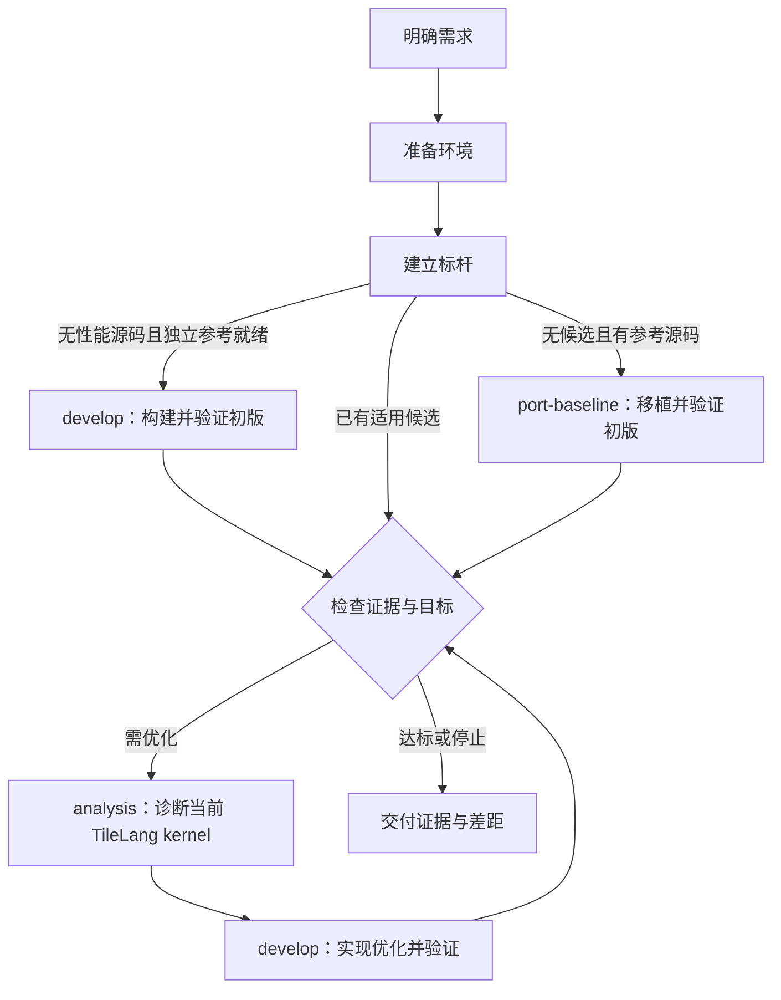

<div align="center">

# Operator Harness

**从算子需求，到可验证、可复现的昇腾内核。**

面向华为昇腾 NPU 的 AI 算子开发工作流。<br>
以 TileLang 为起点，连接需求分析、算子编写、实卡验证与性能调优。

[工作流程](#工作流程) · [目标能力](#目标能力) · [使用方式](#使用方式) · [路线图](docs/ROADMAP.md) · [开发文档](#开发文档)

</div>

> **项目状态：早期建设中。** 已提供面向 Codex 的初始化、接入、接续及五个节点 skills，以及 status、next、automatic 入口。另有 torch_npu 性能采集方法和解析脚本。节点职责见 [节点设计](docs/nodes/design.md)；已实现结构化接收、失败关闭、可选预算/job 账本、本地 Python 评测入口、进程 runner 和安装升级回滚；通用设备适配、MCP 和 npm 分发见 [路线图](docs/ROADMAP.md)。

## 什么是 Operator Harness

Operator Harness 旨在把算子开发中的需求、知识、工具和验证结果组织成一个 agent 可以持续执行的流程。

用户描述算子的功能、输入范围和性能目标，harness 引导 agent 明确验收条件、检查环境、建立标杆、编写实现，并根据真实运行结果反复改进。最终交付包括算子代码、正确性结果、性能对比和复现说明。

首批仅接入 [tile-ai/tilelang](https://github.com/tile-ai/tilelang)。语言适配保留扩展空间，AscendC 等独立语言入口在后续按需求评估。

## 为什么做这个项目

算子开发需要同时处理数学语义、编译器能力、硬件约束和测量方法。一次代码生成之后，往往还有大量工作：确认动态 shape 的含义、处理非对齐输入、定位精度差异、准备远程环境，以及判断性能变化是否可信。

我们希望把这些工作沉淀为可重复的流程：

- **需求有边界。** 在实现前明确 shape、dtype、布局、误差、外部约束和验收目标。
- **执行有反馈。** 编译错误、精度反例和性能样本进入下一轮修改。
- **结果有依据。** 每份结果关联具体候选、输入、工具链和执行环境。
- **迭代可接续。** 保存当前进度、失败原因和最佳已验证候选，让后续会话能够继续工作。

## 工作流程

每个算子围绕同一条主路径推进：



1. **明确需求**：确定功能语义、动态 shape 行为、case 范围、数值要求和外部约束。
2. **准备环境**：多轮确定 Python、TileLang、torch/torch_npu 与 CANN，准备并验证共享上板环境；后续复用确切绑定，只补变化或缺口。simulator 接入另行设计。
3. **构造标杆**：分别建立正确性参考和性能基线，固定输入、误差容限与测量协议。
4. **标杆移植**：没有适用候选时，port-baseline 将参考策略映射为 TileLang 初版，自行替代 AICPU 等缺口，在同一节点内完成精度、性能测量及诊断交付；已有候选跳过；无适用性能源码时固定独立正确性参考、初版方案和绝对/模型目标，使用 develop 的 initial-and-validate。
5. **迭代调优**：测试后需要改进时回到 analysis，通过反例、仿真和流水证据定位问题，形成修改假设，交给 develop 实现并再次验证。
6. **回归与交付**：保留最佳已验证候选，汇总全部必选 case；预算耗尽时明确报告尚未达成的目标。

analysis 是默认迭代节点；是否运行新仿真或流水采集由问题、已有证据和预算决定，纯源码分析不依赖仿真就绪。单独测试使用 `harness-develop` 的 verify-only 模式。目标达成就结束，性能收益最终通过约定的实卡测量验证。

随包的 [Ascend950 仿真 Skill](assets/skills/ascend950-simulation/SKILL.md) 提供采集指导、msprof trace 增强、npusim SQLite 导出和 Insight 兼容说明。analysis 按任务绑定的仿真约定使用；已有 trace 可离线处理。

port-baseline 与 develop 的精度失败都在原节点修复，不能接收。初版精度通过、实现符合移植方案且测量有效时，可以带性能差距交给 analysis。性能退化先归因：实现问题在节点内修复，思路问题附精度通过、性能结果及归因证据交给下一 analysis；预算或环境阻塞保留未验收状态。

多个独立分析方案可通过 [并行开发](assets/skills/harness-resume/references/parallel-develop.md) 分别实现和测试：每个任务独立 worktree、缓存和产物，同一设备上的测量排队。协调者比较结果后选择候选，组合修改后重新验证。

## 目标能力

| 能力 | 目标体验 |
| --- | --- |
| TileLang 算子编写 | 按当前上游文档、示例和任务约束生成与修改算子 |
| 实卡精度验证 | 独立参考、边界 case、全部输出比较和可复现失败样本 |
| 实卡性能验证 | 固定基线、预热与重复采样、逐 case 对比，保留回退结果 |
| 标杆移植 | 生成并验证 TileLang 初版，记录移植对应与能力替代 |
| kernel 分析 | 对照标杆与实测证据，按需仿真/流水分析定位已有候选缺陷 |
| 多环境执行 | 在本地或远程的 host/docker 环境完成任务并回收结果 |
| 实验记录与恢复 | 保存候选、日志、环境身份、阶段状态和验证证据 |
| 项目接入与分发 | 通过 CLI 将所需能力安装到用户已有的算子项目 |

### 执行环境

仿真与实卡测试都以以下四种环境组合为目标，逐项验证兼容性：

| 执行位置 | 环境 | 仿真 | 实卡精度 / 性能 |
| --- | --- | --- | --- |
| 本地 | host | 规划中 | 规划中 |
| 本地 | docker | 规划中 | 规划中 |
| 远程 | host | 规划中 | 规划中 |
| 远程 | docker | 规划中 | 规划中 |

每个组合还需明确芯片和工具链版本。编译位置与运行位置分别记录，支持远程执行不代表客户端可以省略全部编译依赖。

### Skills、MCP 与 hooks

| 机制 | 在项目中的职责 |
| --- | --- |
| **Skills** | 提供算子开发、API 检索、调试和优化方法，按任务需要加载 |
| **MCP** | 优先提供候选执行包与设备执行接口，后续扩展 simulator 仿真接口 |
| **Hooks** | 在任务和工具事件发生时记录信息、执行检查、更新状态 |
| **工作流与评测程序** | 根据实际证据推进阶段，判断精度、性能和任务完成情况 |

执行能力优先评估复用现有 simulator 与基于 DeepJIT 的 Onboard，技能按可移植性选择性迁移。详见 [现有资产复用计划](docs/REUSE_PLAN.md)。

## 使用方式

### 当前可用：Codex 项目流程与节点 skills

本仓库已通过 `.agents/skills/` 提供工作流与配套技能，在 Codex 中选择或输入：

```text
$harness-new-project 为我的 TileLang 算子项目明确需求并建立路线图。
$harness-onboard 梳理这个已有项目的代码、文档和验证方式，建立后续计划。
$harness-resume 先恢复目标、当前性能和优化历史，再继续下一步分析或调优。
$harness-status 查看指定项目或列出项目摘要，不执行实验。
$harness-archive-project 冻结或归档项目，保存可恢复现场。
$harness-restore-project 检查并恢复被冻结或归档的项目。
$harness-next 直接推进一个下一步，完成后返回。
$harness-automatic 在已有目标和预算内连续推进当前任务。
$harness-prepare-environment 多轮确定 Python、TileLang 配套与 CANN，准备并验证本项目使用的上板环境。
$harness-establish-baseline 根据已绑定环境调查参考实现，验证并固定正确性参考和性能标杆。
$harness-port-baseline 将参考标杆移植为 TileLang 初版，自行替代 AICPU 等缺口并验证。
$harness-analysis 对照标杆、测试与流水证据，定位当前 TileLang kernel 的问题。
$ascend950-simulation 按已绑定的仿真环境校验输出并导出流水 trace，或离线处理已有采集。
$harness-develop 按已接收的分析方案和开发约定编写或修复 TileLang 候选。
$harness-develop 只验证当前候选：使用已有上板约定完成精度和性能测试。
```

`harness-new-project` 用于新项目的需求澄清和规划；`harness-onboard` 用于已有项目接入，这里的 onboard 不执行 NPU 上板。CLI/IDE 也可通过 `/skills` 选择技能；本项目没有注册 `/harness-*` 顶层 slash commands。若技能尚未出现在宿主中，重启会话后再检查。发现与调用方式见 [Codex 技能文档](https://learn.chatgpt.com/docs/build-skills)。

五个节点 skills 提供方法与工具路由，使用已核实的实际工具。环境准备先确定 conda/venv 等 Python 方案、TileLang 与 torch/torch_npu 版本，再与 CANN 的复用或安装方案核对；已有选择不重复问。共享上板描述位于 `.workspace/environments/onboard/<id>/`，项目绑定确切修订及自身使用约定。simulator 新接入后续设计，旧仿真约定仍可读取；上板验证不等于仿真验证。详见 [环境契约](assets/skills/harness-prepare-environment/references/environment-contract.md)。

`harness-new-project` 和 `harness-onboard` 共用连续追问流程：沿着回答深入，用具体场景澄清歧义，理解充分后复述并进入规划，或按用户选择继续探索。已有项目先吸收代码和文档，只追问未知项与实际冲突；明确的“直接生成”指令不再重复确认。未结束的讨论暂存在 `.workspace/<project>/drafts/`，已有阻塞问题在下次调用时继续澄清。

要在其他项目使用，从本仓库根目录执行（安装脚本使用 Python 3）：

```bash
python3 scripts/install_codex_skills.py --workspace operator-workspace
```

安装到用户显式选择的工作目录，不自动提升到 Git 根；旧 --project-dir 参数作为 --workspace 的别名。安装器复制随包提供的技能到 `.agents/skills/`，向 `AGENTS.md` 追加接续指引，并在 `.gitignore` 中加入 `.workspace/`，保留已有内容。重复安装不会重复追加；只比较随包提供的技能文件，用户额外添加的文件保留不动。随包文件或已有 Harness AGENTS 区块存在不同内容时在复制前报告冲突，保留用户文件；不静默沿用旧路径入口。安装清单、升级计划、中断恢复和回滚已提供，见 [升级说明](docs/installation-upgrades.md)；卸载与 npm 分发继续按路线图建设。

Agent 在选定项目的 `.workspace/<project>/` 中维护 `PROJECT.md`、`REQUIREMENTS.md`、`ROADMAP.md` 和 `STATE.md`，接入已有项目时补充 `codebase/MAP.md`。这些都是可以直接编辑的 Markdown，按项目进展逐步建立；未决问题和下一步留在状态记录中，草稿与研究材料按需保存。

PROJECT 使用 [项目模板](assets/skills/harness-new-project/assets/templates/project.md) 固定目标仓库规范、早期检查和交付条件。develop 记录适用预检；收尾使用 [交付模板](assets/skills/harness-resume/assets/templates/delivery.md) 对照发布版与实测版，逐项说明证据可复用、需补测或未验证。详见 [项目契约](assets/skills/harness-new-project/references/project-contract.md)。

标杆建立由 `harness-establish-baseline` 完成：明确比较语义、调查候选及版本、先验证正确性再测量性能，输出 run 内的 `BASELINE.md` 和原始证据。协调者发布 `.workspace/<project>/BASELINE.md` 索引，下游固定具体修订复用。只调查可以完成任务但不等于标杆 ready；“最快”仅指声明的调查范围和实测条件。节点收尾在最终回复与记录中都给出一个具体下一步建议，用户要求停止时不继续执行。

后续工作通过 `harness-resume` 接续：`STATE.md` 保存当前候选、最佳已验证候选、性能概况与下一步；`EXPERIMENTS.md` 记录成功、失败和无收益的尝试；`runs/<编号>/` 保存对应代码、详细结果与日志。新的 agent 先读摘要，再按需要打开相关实验。

允许同一会话连续执行多个节点，同时保证记录足以让全新 agent 独立接续。当前 agent 可以完成节点与共享汇总，也可按需委派；全新 agent 只接收工作目录根和 TASK 路径。上下文过长时只建议用户新开会话，不强制切换，也不因缺少委派工具阻塞。`automatic` 已通过当前宿主的主/子 agent 能力串行协调节点，无委派工具时明确采用 inline；不是脱离会话的后台服务。使用新机器或 worktree 时，需要带上被 Git 忽略的 `.workspace/` 记录和相关产物。具体交接方法见 [节点契约 与六份模板](assets/skills/harness-resume/references/node-contract.md)。TASK 包含做什么、输入身份、工具入口/执行步骤、权限预算与完成条件；用户问询答案保存到 DECISIONS，启用结构化控制后，实时占用以 search/tree.json 的 control 为准，RESOURCE_USAGE 保存索引；未启用的旧任务保留原账本。

### 查看、单步与自动推进

`status` 只读汇报进展、证据、在途/阻塞与一个推荐动作。`next` 会直接做这一步并更新记录，不再问是否开始，但实际缺失的选择仍会问询。`automatic` 连续执行同一套选择逻辑，主 agent 接收每个节点的结果后才推进；复用各自环境约定，不反复访谈。

自动模式记录 `.workspace/<project>/AUTOMATIC.md`。用户/已有约定的预算优先；未指定控制上限时每批默认最多 8 步，这不提供任何新增设备额度。目标达成、需要输入、预算耗尽、无可执行动作或用户要求暂停时保存结果与恢复入口。详情见 [运行模式](docs/modes/design.md)。

### 多项目管理

一个工作目录支持多个项目；名称在初始化时与用户确定，一个项目可包含多个算子。每个项目拥有 `.workspace/<project>/project.json`、记录、独立源码 worktree 和专属依赖/构建。共享环境描述位于 `.workspace/environments/`，每项目绑定具体修订。默认只展开 active 项目；freeze/archive 保留现场，restore 检查后激活，不自动重启实验。详见 [项目管理](docs/projects/design.md)。

### 搜索树与 hot/cooled 知识

一个项目的算子或融合优化方向组织成多层搜索树，每个节点可以经历多轮分析、编写、测试；候选谱系、当前/最佳候选和资源预算仍独立管理。Hot 关联一个或多个节点并保留证据与修订；交付时整理筛选，经真实人工审批后生成可版本管理的 cooled 知识，供后续探索按需引用。

随 harness-resume 安装的 Python 标准库工具 `searchctl.py` 提供原子记录、幂等恢复、引用校验及知识晋升/失效管理。@4 任务增加逐 case 验收与候选晋升、安全关闭、机制查重入口，以及可选步数/资源/job 账本和只读 reconcile；见 [执行控制契约](assets/skills/harness-resume/references/execution-control.md)。工具不启动实验或自动发布；[评测入口](assets/skills/harness-develop/references/evaluation-runner.md) 执行冻结的参考/比较器并自动生成证据，[本地 runner](assets/skills/harness-develop/references/local-runner.md) 管理前台命令及控制账本。真实设备适配仍按执行矩阵验收。见 [架构示例](docs/search/design.md) 和 [CLI 与契约](assets/skills/harness-resume/references/search-knowledge.md)。

### 规划中：npm 分发与执行闭环

计划通过 npm 分发 CLI，让用户在自己的算子项目中初始化 harness，再通过所选 coding agent 开始工作。以下为接口示意，包名尚未确定，不能直接执行：

```text
npx <package>@<version> init
npx <package>@<version> doctor
```

`init` 计划接入所需 skills、指令与工具配置；`doctor` 检查接入状态和执行环境。升级、卸载及已有配置的合并也属于发布计划。

初始化后的目标交互是一项明确的算子任务，例如：

> 使用 TileLang 为目标昇腾设备实现这个算子。输入规格、参考实现和业务 case 已提供；请先检查需求与环境，建立精度和性能标杆，再实现并调优，最后给出逐 case 结果和复现说明。

首个 agent 宿主已确定为 Codex。可从 [需求与工作流](docs/REQUIREMENTS.md) 了解任务需要提供的信息。

## 如何判断完成

目标工作流以可检查的证据作为完成条件：

- 编译成功、实卡精度通过和性能达标分别记录。
- 候选代码、输入范围或环境变化后，重新取得受影响的验证结果。
- 正确性参考与性能基线分别管理，调优保留固定的比较条件。
- 仿真 cycle、设备任务时长和端到端延迟分别报告。
- 超时、缺少设备数据和残缺采集保留诊断记录，不记为成功。
- 保留全部必选 case 的结果，以及性能回退、未达标和未验证项。

结构化检查已进入 @4 接收实现；原始比较器、设备适配和科学解释仍需独立核验。CPU 回归不代表真实 NPU 闭环通过。

## 路线图

| 阶段 | 交付目标 | 当前状态 |
| --- | --- | --- |
| M0–M1 | 项目定位、任务需求、环境与验收契约 | 文档与资产初查已建立，任务契约待冻结 |
| M2 | 首个 TileLang 实卡开发与验证闭环 | 接收/控制与本地进程工具已实现；通用设备适配和实卡验收待完成 |
| M3 | CLI 初始化和一个 agent 宿主接入 | Codex 初始化 skills 与源码安装器已实现；npm CLI 待建设 |
| M4 | 执行矩阵、仿真 MCP、流水分析能力与恢复 | 待开始 |
| M5 | 升级、卸载和独立发布 | 源码安装的升级/回滚已实现；卸载与独立发布待完成 |
| M6 | 更多算子、宿主与按需语言扩展 | 后续演进 |

阶段验收条件与待决事项见 [完整路线图](docs/ROADMAP.md)。

## 开发文档

| 文档 | 内容 |
| --- | --- |
| [整改状态与剩余缺口](docs/workflow-improvements.md) | Harness 工程审查、已实施修复和验证边界 |
| [安装升级](docs/installation-upgrades.md) | 安装清单、升级计划、恢复与回滚 |
| [依赖队列](assets/skills/harness-resume/references/task-queue.md) | 自主选择 analysis/develop、冻结输入、独立工作空间与恢复 |
| [开发能力](docs/develop-capabilities/design.md) | cannbot 方法接入、实现检视与测试可信度 |
| [多项目管理](docs/projects/design.md) | 项目定位、源码隔离、冻结与恢复 |
| [开发路线图](docs/ROADMAP.md) | 阶段安排、验收条件和待决事项 |
| [需求与工作流](docs/REQUIREMENTS.md) | 算子需求清单、标杆构造、阶段检查和执行矩阵 |
| [现有资产复用计划](docs/REUSE_PLAN.md) | Skills、simulator、Onboard 与 GSD 的检查结果和迁移方向 |
| [五节点设计](docs/nodes/design.md) | 环境问询与分立约定、节点交接、证据身份、失败恢复和验收 |
| [运行模式](docs/modes/design.md) | status 只读汇报、next 单步执行、automatic 有界协调与恢复 |
| [技能参考来源](docs/nodes/skill-sources.md) | 外部资料入口、许可核对、采纳位置及适用边界 |

## 参与开发

当前开发仅限 `harness` 分支及其派生分支。开发文档统一放在 `docs/`，随阶段推进补充设计与实现依据。

对外交付的技能维护在 `assets/skills/`；本仓库的 `.agents/skills/` 通过相对软链接使用同一份内容。

`.workspace/` 用于中间产物、临时实验、日志和本地备份，已加入 `.gitignore`。需要长期复现的任务定义、最终代码和必要报告进入版本管理。

## 设计参考

项目参考 [GSD Core](https://github.com/open-gsd/gsd-core) 的阶段化工作方式与持久状态组织，围绕算子需求、标杆、实卡验证和调优迭代建立自己的完成条件。首批两个入口已借鉴其流程并独立实现，不依赖 GSD runtime；[参考来源与许可](assets/skills/harness-new-project/references/provenance.md) 随技能保留。后续执行流是否整体引入 GSD 仍待评估。
