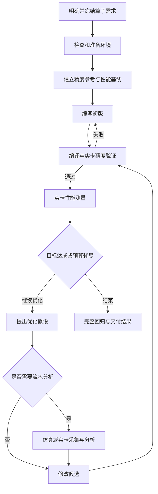

# 昇腾算子生成：需求与工作流

状态：需求初稿。用户已明确的目标与本文建议的执行方式分别标注；接口和实现细节尚未冻结。

## 1. 已明确的产品方向

本项目面向华为昇腾 NPU，帮助 agent 完成算子编写、实卡精度与性能验证，以及可选的流水分析。

- 语言可扩展，首批仅接入 TileLang；AscendC 为后续可选扩展，不作为首批交付条件。
- TileLang 指用户指定的 [tile-ai/tilelang](https://github.com/tile-ai/tilelang)。本仓库清空前的 NPUIR 实现不作为默认语言后端。
- 仿真和实卡测试均需要支持本地/远程与 host/docker 的四种组合。
- 算子编写方法可从现有 asc-devkit skills 选择性迁移；仿真与上板执行优先评估复用 simulator 和 Onboard。
- simulator 是 MCP 封装的优先候选。Onboard 可在保留有效能力的基础上重构。
- GSD Core 是工作流参考或候选依赖，尚未决定整体引入。
- 首个宿主为 Codex。项目初始化与已有项目接入借鉴 GSD 流程，使用本项目的 `harness-new-project`、`harness-onboard` 名称，运行记录统一放入 `.workspace/`。
- 延续独立分发目标，通过 `npx` 初始化和使用，宿主、设备路径与工具链配置不能绑定开发者机器。

当前 TileLang 上游的 [Ascend 文档](https://github.com/tile-ai/tilelang/blob/0176ba1465b12758f41802bf838ddd68d43c9ee9/tilelang/ascend/README.md)面向 Ascend 950。具体支持的芯片与 CANN/TileLang 版本组合仍需实际验证，不能从“面向昇腾”推导出全部芯片可用。

## 2. 算子需求需要收集什么

以下清单用于任务访谈和后续任务格式设计。每项填写具体约束，或明确“不适用”；影响验收的未知项在执行前解决，不替用户默选宽松条件。

| 类别 | 要明确的内容 |
| --- | --- |
| 功能语义 | 公式、输入输出、参数默认值、广播/归约规则、融合范围、前向或反向、是否有状态 |
| Shape 契约 | rank、维度关系、合法范围、代表性 case、业务权重、极端大小、非对齐尾部、空输入是否允许 |
| 动态性 | 哪些维度在运行时变化；允许按 shape JIT 特化还是要求一个编译产物处理多种 shape；是否存在数据相关输出长度 |
| 数据表示 | 输入/输出/累加 dtype、量化参数、layout、stride、连续性、对齐要求、原地更新和输入输出别名 |
| 数值语义 | 数值范围、NaN/Inf、溢出、舍入、近似计算许可、确定性要求、误差指标及容限 |
| 正确性用例 | 输入分布、随机种子、边界与对抗输入、全部输出比较、非法输入行为、额外数学不变量 |
| 性能目标 | 对比对象、每个 case 的指标、加速目标或耗时上限、允许回退的范围、汇总权重、吞吐或延迟 |
| 测量范围 | 单 kernel、多个 kernel 的完整算子，还是包含传输的端到端调用；编译和首次运行是否单独计量 |
| 外部约束 | 允许的库与调用、是否允许算法替换或 CPU 回退、workspace 上限、预处理成本、禁止修改的接口和文件 |
| 集成方式 | Python/C++ 调用接口、参数 ABI、stream 与同步要求、内存所有权、动态 shape 的传参和 launch 规则 |
| 环境约束 | 芯片型号、软件版本、编译位置、运行位置、host/docker、内存和磁盘、设备使用范围、网络与权限 |
| 预算与交付 | 最大尝试次数、设备时间、超时、停止条件、交付源码/测试/报告范围、未达标时的报告要求 |

动态 shape 不能只记录一个布尔值。例如“支持 N 在某范围内变化，但每个 N 可重新编译”与“同一个二进制接收运行时 N”是不同的验收要求。

## 3. 建议工作流与阶段检查

建议采用下面的顺序。主路径中的检查由程序判定，skill 提供执行方法；人工参与需求选择和重大范围变更，不要求每次调参都重新审批。

仿真也可在实现阶段辅助定位问题；启用位置由任务配置决定。它不替代主路径的实卡精度和性能验收。

| 阶段 | 主要产物 | 进入下一阶段的条件 |
| --- | --- | --- |
| 需求确定 | 带版本的任务规格、case 集、验收规则 | 关键语义、约束和目标已明确 |
| 环境准备 | 环境身份、能力检查、最小编译/运行探针结果 | 所选执行组合真实可用，所需依赖与设备可访问 |
| 标杆构造 | 正确性参考、固定输入、性能基线及测量协议 | 参考经过检查，基线满足同一语义与比较条件 |
| 初版编写 | 候选源码、编译参数、launch 描述 | 编译产物与当前候选绑定 |
| 实卡精度 | 每个必选 case 的比较结果与失败样本 | 全部必选精度检查通过，未运行项不计通过 |
| 实卡性能 | 原始样本、统计量、逐 case 基线比较 | 样本有效，测量范围明确，满足预定采样要求 |
| 可选分析 | 原始 trace、分析摘要、待验证假设 | 数据来源与完整性明确；分析结论用于指导实验 |
| 调优迭代 | 修改理由、候选差异、重新验证结果 | 候选变更后重新取得相应精度与性能证据 |
| 最终交付 | 最佳已验证候选、完整回归、复现命令和限制 | 报告准确区分达标、未达标、未验证及预算耗尽 |

环境准备先检查再补齐依赖，记录实际附加约束。如果环境限制迫使缩小 shape 范围或改变算法，返回需求阶段更新版本，不能静默修改目标。

### 3.1 精度参考与性能基线分别管理

精度参考负责定义预期结果，性能基线负责提供可比较的耗时。它们可以是不同实现，例如高精度 CPU 参考与现有 NPU 库实现。

参考实现应独立于候选实现，并通过小型可核对 case、数学不变量或其他可靠依据检查。测试输入、参考和容限不能随调优候选一起改到“通过”；修正参考需要记录原因并重新验证受影响结果。

性能比较要固定 case、dtype、布局、计算范围和环境，记录预热、同步、采样次数、输入/输出重置以及统计方法。多 kernel 或 AIC/AIV 重叠执行不能简单累加各任务时长代表算子延迟。远程请求耗时、仿真 cycle、带流水采集开销的时长与常规实卡性能分别报告。

每个 case 都保留结果，包括慢于基线的 case。汇总方法事先约定，不能只展示优化后较好的子集。若找不到可用性能基线，先记录缺口并确定替代验收指标，不生成虚构的加速比。

### 3.2 证据失效与停止规则

建议用任务版本、候选源码/产物摘要、环境身份和测试协议版本关联结果。

- 候选、编译参数或 launch 方式变化：重新编译并验证，不复用旧候选的通过标记。
- case、容限或参考变化：重新完成对应正确性验证；输入范围变化时重新建立性能比较。
- 设备、工具链、容器镜像或测量协议变化：检查编译兼容性，重跑受影响的正确性与基线/候选测量。
- 失败候选不覆盖最佳已验证候选。调优达到预算或连续无收益阈值时停止，明确是否达标。
- 超时、断线和残缺 profile 保留诊断材料，不能记为成功；重放前确认原任务状态与副作用。
- 可选分析失败时单独报告；任务未要求该分析为验收条件时，不抹去有效的实卡结果。

这些规则应从最小闭环开始实现，后续阶段再增强恢复和调度能力。

## 4. 语言、执行环境和分析能力分开扩展

建议按三个独立维度组织适配，具体接口留给下一份设计：

| 维度 | 职责 | 首批范围 |
| --- | --- | --- |
| 语言适配 | 文档与示例、源码入口、编译/导出、ABI 和 launch 信息 | 仅 TileLang |
| 执行适配 | 环境探测、文件传输、进程/容器、任务状态、结果回收 | local/remote × host/docker |
| 任务能力 | 精度验证、性能测量、仿真、流水采集与分析 | 实卡精度/性能必选，流水分析可选 |

语言身份需要包含仓库/版本、dialect、target 与编译选项。TileLang 产生 AscendC 代码后仍属于 TileLang 来源的候选，要保留从 DSL 到二进制的关系；处理这类生成产物不等于接入独立 AscendC 算子编写入口。上板不应只能依赖固定源码形式；所需产物、入口、参数和 launch 约定由语言适配提供。

“本地/远程”描述执行机器相对 CLI 的位置，“host/docker”描述该机器上的执行环境。编译位置与运行位置另外记录，不能假设选了 remote 就无需本地工具链。

### 4.1 目标执行矩阵

下表是产品要求，全部尚未在本 harness 中实现。首批使用 TileLang，按芯片和工具链版本逐组合验证兼容性。

| 执行位置 | 环境 | 仿真 | 实卡精度/性能 |
| --- | --- | --- | --- |
| 本地 | host | 目标支持 | 目标支持 |
| 本地 | docker | 目标支持 | 目标支持 |
| 远程 | host | 目标支持 | 目标支持 |
| 远程 | docker | 目标支持 | 目标支持 |

先选择一套可用环境完成 TileLang 闭环，再逐格扩展；不能用一个组合的成功宣称整个矩阵可用。Docker 模式需要独立检查镜像、挂载、架构、权限和实卡设备访问；远程模式还需验证连接、传输、回收和异常清理。

### 4.2 MCP 候选边界

建议把 simulator 已有命令作为内部执行能力，通过 MCP 暴露环境检查、提交仿真、查询状态、取得产物、取消任务和分析结果。名称与参数尚未冻结。

长任务返回可查询的任务标识，结果指向原始日志/trace 和结构化摘要；MCP 不承担工作流决策，也不把大体积 dump 全塞进模型上下文。超时后需要知道任务是否仍在运行、产物是否完整、清理是否完成。

本地和远程执行应共享任务语义。MCP server 的部署位置与实际执行位置是独立选择；可以由本地 server 调度远程任务，具体方案在执行适配设计时决定。Onboard 是否也提供 MCP 外层接口保留为待决项。

## 5. GSD 的取舍

[GSD Core 的阶段流程](https://github.com/open-gsd/gsd-core/blob/1ec5c812b79dc1cc487d0873d18b03449b11c106/docs/explanation/the-phase-loop.md)提供 Discuss、Plan、Execute、Verify、Ship 的组织方式，以及跨会话保存决策和验证结果的方法。该资料用于流程参考，本项目尚未安装或验证 GSD 集成。

已独立实现两个初始化入口，使用方式见 [README](../README.md#使用方式)。这次借鉴限定在需求澄清、代码现状梳理、计划与恢复，不预先决定后续执行阶段是否整体接入 GSD。

建议先采用阶段产物、明确完成条件和可恢复记录。选择整体依赖 GSD 还是自己实现流程，需在 M1 用一个算子流程对照评估：

- 是否能表示“精度失败不能进入性能优化”和候选变更后的证据失效。
- 是否方便表达精度参考、性能基线、可选分析与反复调优。
- 中断恢复是否保留原始证据及最佳候选。
- 每次迭代的上下文、文档和调度成本是否可接受。
- 是否能复用现有宿主，而不要求每个小调整都创建 PR 或完整阶段。

强约束来自可执行的阶段检查。提示词、额外 reviewer 或更多文档本身不构成正确性保证。初版可以串行调度独立上下文的子 agent，通过实验记录交接；并行吞吐与独立调度服务属于后续优化选项。接续流程见 [harness-resume](../assets/skills/harness-resume/SKILL.md)。

## 6. 下一步需要确定的内容

1. 首个代表性算子及其最小/边界/业务 case，是否要求真正的运行时动态 shape。
2. 首个支持的芯片、工具链版本和执行组合，以及可用环境的访问方式。
3. Codex 的执行工具接口，以及后续执行阶段整体接入 GSD 或借鉴流程的选择依据。
4. 首个精度参考、性能基线和验收指标。

这些问题阻塞具体执行契约冻结，不阻塞当前背景整理。现有工具的证据与迁移建议见 [复用计划](REUSE_PLAN.md)，实施顺序见 [路线图](ROADMAP.md)。
