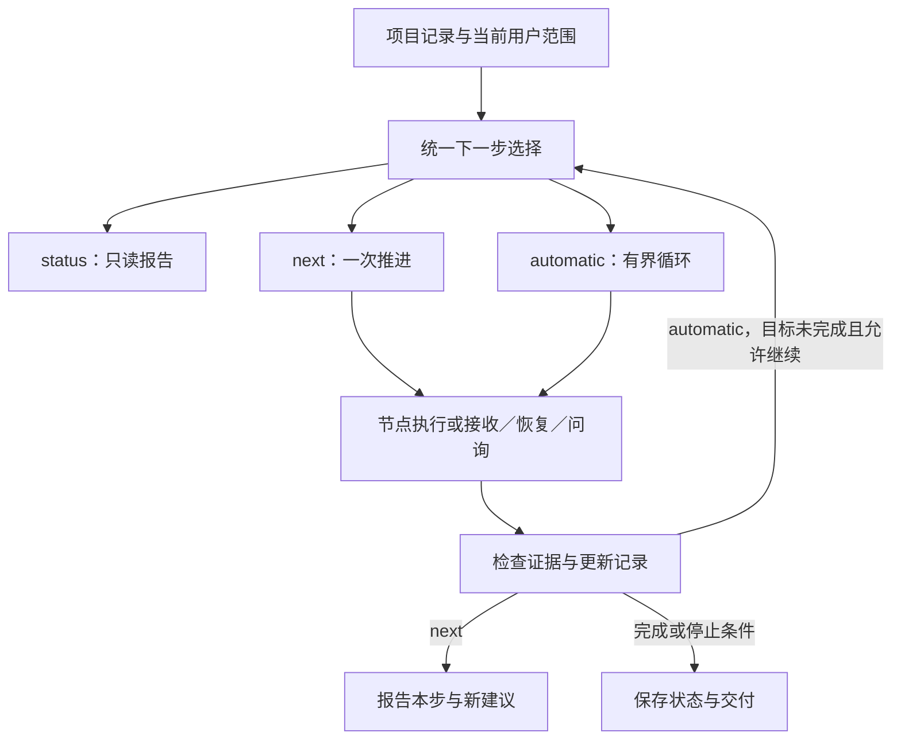

# status、next 与 automatic

> 状态：三个 skill 入口与宿主内编排流程已提供；独立后台调度器、npm CLI 和自动程序 gate 未实现。实际节点能力取决于项目已有工具及环境证据。

## 1. 目标与范围

用户需要三种清楚的操作：看当前进展、推进一个下一步、围绕当前目标持续推进。三者必须共享判断依据，避免 status 建议修复，next 却按陈旧 STATE 去跑性能。

当前实现沿用 skills、Markdown 项目记录和宿主工具，不增加另一套任务数据库。automatic 由主 agent 协调节点子 agent；没有委派工具时明确用 inline 顺序执行。普通交互允许同会话完成多个节点，不要求用户新开聊天。

## 2. 入口语义

| 入口 | 行为 | 结束边界 |
| --- | --- | --- |
| `harness-status` | 只读当前任务、候选/证据、预算与在途状态，给出一个推荐下一步 | 给出报告；不写文件、不执行节点 |
| `harness-next` | 重新核对推荐，直接完成一个有界动作，包括必要接收与共享记录更新 | 一个节点、接收/恢复动作或必要问询边界；不自动进入第二节点 |
| `harness-automatic` | 主 agent 循环选择、派发、等待与接收，直到目标或停止条件 | 当前目标完成、需要回答、预算边界、阻塞或用户暂停 |

这些是 skill 名与自然语言入口，不新增裸 slash command，也不是 npm CLI 命令。status 默认只反映记录；用户额外要求实时查询才在现有约定下有限查询，需标明数据时间。

## 3. 与五节点的关系

resume 继续提供读取、TASK/RESULT、接收与共享记录规则。三入口共用 [下一步规则](../../assets/skills/harness-resume/references/next-action.md)；五个节点仍遵守 [节点契约](../../assets/skills/harness-resume/references/node-contract.md)。协调入口不成为额外的算子执行节点，子 agent 不递归调用 automatic。

## 4. 决策与推进

按当前任务选取相关记录，实际证据优先于陈旧的“下一步”文字。先处理在途/未知作业及未接收交付，再判断目标达成、缺失选择、环境缺口、相对性能所需标杆的建立/更新、首次标杆分析、候选构造、精度/性能测试及后续kernel问题分析。默认循环为analysis → develop → device-test → analysis；已接收分析按输入身份复用，测试失败先分析，目标完成则停止。只检查当前目标必需的条件：静态交付不用等待设备，旧 trace 分析不用重建仿真环境，可选仿真不用强行执行。

缺少 STATE 或任务歧义：status 报告缺口与建议；next 直接开始必要的初始化/澄清；automatic 在明确范围前问必要选择，不默认执行整个路线图。已有准备好的 TASK 也须检查身份和范围，不能因文件存在就执行。

next 一步含节点内部的编译/比较/采样及接收，不按工具调用计数。若已有结果未接收，接收就是本步。若有作业运行，等待/恢复该作业就是本步，不能重复提交。用户只要求精度时不添性能。

automatic 的默认策略为串行独立上下文子 agent，派发只给根目录和 TASK 路径；主 agent 记录实际 agent/run/job、等待产物并接收，不在“已派发”时就结束并宣称完成。工具不可用时明确 inline，保持相同节点记录和边界。独立调度服务不是当前实现的一部分。

## 5. 有界自动运行

用户给定范围与预算优先；没有本批次控制上限时默认最多 8 个控制步骤，开始时说明并落盘，不额外审批。一次节点工作、接收、恢复或问询各是一个有界控制动作，开始前占用步数，失败/中断也计入；同一步的重连与收尾不重复计数。

控制步数不替代环境资源账本，不授权新的机器、安装、设备操作或无限测试。每次动作仍需符合该侧环境约定和资源预留。新一批可归档上批次并建立关联；普通重连不能清零，同批额度耗尽不能自动续期。

目标完成优先于耗尽剩余步骤；一次有效失败诊断可以生成下一项修复，但相同输入/动作/环境无新依据时不能循环换 run/agent 重试。性能无收益但有新假设时可在剩余预算内继续，所有退化 case 保留。

## 6. 控制记录

automatic 按 [控制模板](../../assets/skills/harness-automatic/assets/templates/automatic.md) 建立 `.workspace/AUTOMATIC.md`，STATE 链接它。内容包括批次 ID、任务范围、协调者、执行策略、状态、max_steps/steps_used、当前步骤及 run/agent/job、步进日志、等待问题与恢复方式。

NODE TASK/RESULT、候选、独立环境约定继续使用六份节点模板；不把全部实验数据复制到控制记录。status 从这些记录投影报告，不另存一份可能漂移的 status 文件。next 不需要为普通一次推进新建 automatic 批次。

同一任务只有一个活跃协调者。第二个入口发现旧控制器时先核实归属与状态，不能覆盖控制记录或启动竞争循环。恢复时记录接管依据并确认旧协调者不再写入。当前以宿主状态和记录检查协调，不声称已具备跨进程分布式锁。

接管协调者只要求确认旧协调者退出；仍活跃的节点由新协调者继续等待。替换节点执行者才确认该节点停止写入。派发前记录步骤/run/意图与可关联请求标识，返回后补实际 agent ID；响应丢失无法核实就阻塞重投，确认未派发则沿原已占步骤完成启动。

接收以 run ID 与 RESULT 摘要去重。共享状态、环境发布和资源结算中途打断时，仅补未完成的更新；不能重复扣减同一消耗或重发同一环境修订。控制步骤最后才标 accepted。

## 7. 停止与用户交互

| 控制状态 | 含义与恢复 |
| --- | --- |
| running | 当前批次推进中，含等待节点；保存当前步骤 |
| needs_input | 真正缺少用户选择；问题落盘并实际提出，答案未到不猜；有效回答后可沿原预算继续 |
| blocked | 工具/资源/身份问题、未知作业或无新依据的重复失败；记录解除条件 |
| budget_exhausted | 不再开始新步骤/实验；保存原在途项并完成允许的收尾，不自动续额 |
| paused | 用户要求停止/暂停/转单步；停止新派发，不等于外部 job 已取消 |
| completed | 本次目标有必需证据，交付和必需收尾完成；不是某个子 agent 单独 completed |

模式切换依照 [共用切换规则](../../assets/skills/harness-resume/references/next-action.md#6-模式切换与接管)，在 DECISIONS 保存来源、作用域、请求和绑定动作；AUTOMATIC 引用该决定。先落盘再等待，恢复不能丢失待生效的切换。

status 不改变正在进行的 automatic，普通查询报告后继续原工作；“只看状态，先别继续”包含独立的显式暂停。用户要求 next 时绑定原在途动作/待接收交付，到完成、needs_input 或 blocked 边界即返回，连续模式保持 paused。普通问题回答不恢复 automatic；用户明确切回 automatic 才恢复连续推进。有原批次时沿用其计数，新批次接入原 next 动作只计一个接续步骤，不重投。独立 next 的新动作记为本次单步授权，不清零旧批次或扩张设备额度。

暂停须通知活跃节点。五节点在新探针、编译、提交、重试或文件修改前及工具返回后检查 live 决定，安全保存后停止新操作；不等待整个多实验节点跑完才响应。暂停不等于已取消正在执行的工具/外部 job，记录和约定内必要回收仍需完成。节点 needs_input/blocked/interrupted 是可接续检查点，completed/failed 才是不可改写终态。

已占步骤的在途节点、已完成待接收结果和原 job 的必要恢复，属于原步骤收尾，不重复占步；控制上限不能成为丢弃其记录或不接收结果的理由。恢复仍受原操作权限、查询上限和环境资源约束，不借收尾新增实验或释放未知占用。

上下文压力只触发保存和建议新会话；用户继续当前会话也可接续。宿主中断或结束不保证后台循环继续运行，下一次调用需恢复记录；不把本模式注册成 Codex 定时 automation。

## 8. 验收与测试

- `MODE-1`：相同项目事实下 status、next 和 automatic 选择一致，陈旧建议不能覆盖精度失败证据。
- `MODE-2`：status 默认不修改任何记录、不启动动作；输出状态来源、缺口和一个推荐下一步。
- `MODE-3`：next 实际执行一个动作并接收结果，第二节点尚未执行；需要信息时实际提问。
- `MODE-4`：automatic 可在宿主内顺序协调至少两个节点，传递落盘候选/结果后按本次目标收尾。
- `MODE-5`：达到上限不再开启新步骤，同一步恢复不清零/重复计数；目标未满足不得写 completed。
- `MODE-6`：unknown job 保留 ID 与额度，不因新入口/新 agent 而重投；已有结果先接收。
- `MODE-7`：暂停/单步/状态查询各自生效，不形成第二个协调者；无委派工具可 inline，不强制新会话。
- `MODE-8`：模式切换期间中断后仍遵循落盘意图；节点安全停下、派发响应未知不重投、部分接收不重复结算。

验证采用独立项目的技能安装/幂等/冲突检查和离线宿主演练，覆盖只读 status、单步 next、双节点 automatic 与预算停止。它们验证控制行为，不替代真实 Onboard/simulator 适配、硬件正确性或自动程序 gate。

## 9. 不在当前范围

无人值守后台服务、npm 命令、定时触发、并行调优调度器、分布式锁、硬件适配器和自动 schema/gate。不因新增自动模式宣称四种执行组合已支持。
