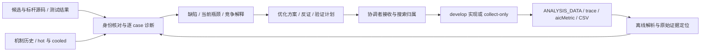

# Analysis：缺陷诊断与优化探索

analysis 绑定当前 TileLang 候选，消费前序上板数据和正式测试结果，交付可验证的缺陷解释与优化提案。入口为 [harness-analysis](../../assets/skills/harness-analysis/SKILL.md)。实现、设备采集、精度与性能验收继续由 develop 完成；本设计补齐分析能力，沿用现有节点、搜索树与接收机制。

## 输入到交付

分析覆盖三层：

- **数据层**：识别 trace 容器与事件、嵌套 aicMetric、CSV 原始字段；绑定候选/构建/case/kernel/launch/pass，保留摘要和原始定位。配套 profile_summary.py 输出统计证据，不推断私有格式、不生成 bound 或达标结论。
- **诊断层**：对齐完整算子阶段、源码/IR、测试与指标；区分精度/实现、测量/采集、性能机制和未知。逻辑工作量、实现开销与物理流量分开；同时检查关键路径、并行/尾块、存储、同步与计算。
- **决策层**：优先级、可执行性、最小修改、反证、精度/退化 case、资源与去留标准进入方案；机制历史查重后建议原节点继续或新策略子节点。

输入与工具接口见 [上板分析](../../assets/skills/harness-analysis/references/device-profile.md)，诊断方法见 [算子分析](../../assets/skills/harness-analysis/references/operator-diagnosis.md)，树融合见 [搜索融合](../../assets/skills/harness-analysis/references/search-integration.md)。这些资源随现有安装器一同分发，不要求安装 cannbot-skills 或访问其 checkout。

## 契约与兼容

TASK/RESULT 继续使用 @4，diagnosis 是正文或附件；profile-input@1/profile-summary@1 只服务离线解析，不构成新的验收 gate。输入 identity 和 scope_evidence 是分析者提供并核对的声明，摘要检查仅证明文件一致性。分析报告的充分性与归因仍由协调者审阅。

现有 search-plan@1、search_node_id、mechanism_id、hot、预算/control 均复用。参数调整、实现修复和同一假设补采保持策略归属；独立新策略由协调者在安全边界建子节点。analysis 不执行 add-node/select/晋升，不因诊断发现实现失败而放宽 develop 接收条件。

精度反例或采集错误可以独立诊断，结论进入修复/重验；性能方向使用正确且身份适用的证据。已有 trace 足够时离线完成，必要补采交 collect-only。缺少可读数据时保留已证实事实，明确缺口与返回条件。

## 验证范围

CPU 测试覆盖事件数组/对象、嵌套指标、CSV 缺失值、唯一 kernel/launch 选择、输入漂移、不同 pass 隔离、区间并集、部分解析和不可覆盖输出。安装测试检查脚本与引用随 bundle 分发。合成数据用于验证解析语义；实际 profiler 版本兼容性和真实瓶颈诊断仍须用任务绑定的上板产物验证。
