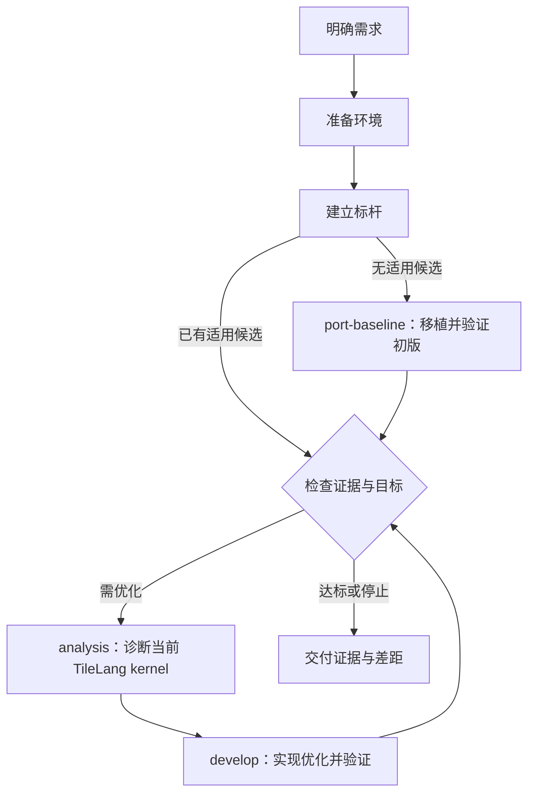

# 五个核心节点的设计

> 状态：五节点及交接模板已提供；@4 程序验收、控制账本和本地 Python 评测入口已实现。下文保留节点职责设计，实际调用以 [执行控制契约](../../assets/skills/harness-resume/references/execution-control.md) 为准；真实硬件闭环待验收。

## 1. 摘要

目前项目已提供初始化、接入与接续流程，但环境、标杆建立、算子编写、上板测试和仿真分析之间缺少明确交接。下一位 agent 容易重复询问环境，或把配置存在、编译成功和目标算子验证混为一谈。

本设计提供五个节点，以一次有上下文的环境问询准备后续实验，分别保存开发、上板、仿真约定并验证必要能力。允许同一会话连续推进多个节点，同时要求项目记录足以让无历史继承的全新 agent 恢复任务、读取自己的约定并接续执行。skills 负责方法与交接，执行工具生成证据，searchctl 负责接收和账本检查。代价是每项节点工作需要写清任务和输入，并在交接或收尾时检查结果；首次环境准备仍需要真正的小型探针。

## 2. 背景与范围

沿用 [需求](../REQUIREMENTS.md)、[路线图](../ROADMAP.md) 和 [复用计划](../REUSE_PLAN.md)：首批语言为 tile-ai/tilelang；上板与仿真目标覆盖 local/remote × host/docker；优先评估 Onboard 与 simulator；GSD 用于参考流程和持久状态，本设计不新增 GSD runtime 依赖。

本设计定义五个节点的职责、技能入口、交接信息、六份模板及节点契约。具体机器、芯片组合和算子由用户任务确定；已有配置供核查，不替用户作选择。

用户已明确：环境准备应通过问询确定后续实验所需环境和约束并验证；后续原则上不重新问环境。**上板与仿真必须各有约定**，包括机器、容器、工具链、资源、允许操作和验证证据，即使物理资源相同也不能互相继承。

## 3. 系统关系

环境索引绑定所需执行能力到各自约定，analysis不是第四种环境角色。源码/旧trace分析无需新仿真环境；新仿真使用simulation，新实卡采集使用device。默认循环为analysis → develop → analysis，测试属于 develop；目标达成则结束，是否采集由问题决定。

## 4. 节点设计

### 4.1 环境准备

入口为 `harness-prepare-environment`。读取需求、已知配置与历史决定，先查可检测事实，再问用户独有的选择和约束。对已有项目只补缺口，未回答的问题不能按超时自动采用推荐值。

环境按 onboard/simulator 两类规划，development、device、simulation 表示执行阶段。当前先提供共享上板环境的指示与模板；开发与上板可以绑定同一描述，也可按实际 lowering/编译/运行位置分别绑定。每个位置明确 local/remote 与 host/container。

按 [上板环境问询](../../assets/skills/harness-prepare-environment/references/onboard-questioning.md) 多轮收敛：先确定 conda/venv 等 Python 环境、复用或新建及版本，再明确 TileLang、torch、torch_npu 的版本与来源，结合 CANN 的复用或安装方案核对兼容性。没有 CANN 时与用户讨论安装方式；依赖这些选择的安装不能先行。已有选择与授权直接复用，不用一张预填配置表代替交互。

按 [环境契约](../../assets/skills/harness-prepare-environment/references/environment-contract.md) 保存共享事实、项目使用约定和实际验证证据。一条适用的小型自校验路径可覆盖依赖加载、编译、设备运行与输出比较；计时按需求验证，不强制逐项拆成独立探针。普通环境通过后即可交接，机器特例只在其环境描述中处理。

simulator 完整接入另行设计，已有仿真约定与证据保留原语义；上板准备不填造仿真 verified。环境验证不代替目标算子验收，资源与权限沿用项目实际约定。

### 4.2 标杆建立

入口为 [harness-establish-baseline](../../assets/skills/harness-establish-baseline/SKILL.md)。根据任务与实际 development/device 约定建立正确性参考和性能标杆。只读调查可先行；正式测量需要可用的编译、输出比较与计时能力和对应预算。仅编写或精度任务不以未测性能标杆作为额外前置。

从用户来源与适用实现调查候选版本，核对完整语义和必要适配开销；记录调查范围、排除理由和停止条件。“最快”只针对可复查的范围与条件，不以最新版本、文档数字或最快单次取代比较。参考、case、协议、统一实现或逐 case 分派规则先固定；每个候选对拟承担范围先完成精度检查，再采样，最终选择必须覆盖全部必选 case。

输出 run 内的 BASELINE、参考/适配与 case/协议快照、原始输出/样本、复测命令及 RESULT。协调者验收后发布 `.workspace/<project>/BASELINE.md` 索引，下游固定具体修订；draft/ready/stale 与节点 completed 分开。环境、参考、case 或协议变化时只重建受影响证据，保留旧标杆。标杆 ready 通常推荐 analysis 分析实现思路；已有有效分析按输入身份复用并遵循统一路由；缺少环境能力推荐 prepare-environment 的具体补齐动作。

### 4.3 标杆移植

入口为 [harness-port-baseline](../../assets/skills/harness-port-baseline/SKILL.md)。无适用 TileLang 候选时读取确切标杆源码/适配和契约，移植其算法、布局、并行、同步及融合策略，在同一节点完成 PRECHECK、全部必选精度、正式性能和任务要求的诊断采集；复用 develop 的验证方法与脚本。PORTING 记录对应关系、替代与限制。

TileLang 候选不引入 AICPU；本节点自行寻找 AIC/AIV 替代并核对全调用链，不新增 AICPU 支持，也不隐藏 host 回退或删除候选的必需计算计时。替代无法满足语义/融合等要求时保留未验收检查点。初版符合移植方案、精度通过且测量有效，可将性能差距交给 analysis，不要求证明优化思路失败；已有候选或初版达标则跳过不必要的后续工作。

### 4.4 分析

入口为 [harness-analysis](../../assets/skills/harness-analysis/SKILL.md)。绑定实际 TileLang 候选、测试结果与移植差异（若有），对照标杆实现分析缺陷；无候选时先进入 port-baseline，不以仅研究参考代替候选诊断。

后续绑定当前候选与最新测试结果，解释精度反例、构建失败或性能差距，按需执行仿真和流水分析。分析已充分的问题可简短交接，不强制重复采集；静态推断不能冒称动态瓶颈。已有分析按输入身份复用，标杆/候选/契约变化只重查受影响部分。

新仿真按simulation约定选择有界case，保存模型、构建与输入身份，检查数值和trace完整性；新实卡采集交给 develop collect-only再返回analysis。原始证据、观察、解释、修改假设分开，模型cycle不直接当设备时间。输出方案或问题诊断及交给develop的具体验证计划，不修改正式候选。具体方法见 [分析方法](../../assets/skills/harness-analysis/references/analysis-method.md)。

### 4.5 开发与验证

入口为 [harness-develop](../../assets/skills/harness-develop/SKILL.md)，默认 implement-and-validate：读取已接收 analysis、固定契约/父候选与 development/device 绑定，编写实现、完成适用 PRECHECK、冻结候选后立即验证，交付同一 TASK/RESULT。只有显式 code-only 才以源码交付为完成条件；环境缺口不能把默认任务偷偷缩为仅编写。

独立参考、完整输出、尾部、stride、别名、累加与动态语义以需求为准。验证顺序为身份/资源检查 → 按需构建/传输 → 全部必选精度 → 任务要求的性能。基线满足同一语义与精度，计时边界、预热、同步、缓存和统计规则固定。profiler 设备记录可以按固定协议作为性能指标，采集进程墙钟不代替设备耗时。仅测试请求使用 verify-only；analysis 的实卡采集使用 collect-only，均不强制改候选。

精度失败与优化实现问题必须在 TASK 预算内修复并重验，未修复不接收；原因未知留在 develop 诊断，预算/环境阻塞保存未验收检查点。精度通过、有效测量和实际实现核对后确认思路问题，才将退化现象与结果交给下一 analysis。结果分别包含编译、逐 case 精度、原始性能样本、采集完整性、目标判定和作业状态；节点 completed 不等于目标达标。具体方法见 [验证协议](../../assets/skills/harness-develop/references/validation-protocol.md)。

develop 还按 TASK 的 diagnostics_required 交付 ANALYSIS_DATA：真实 kernel/候选/输入/环境映射、原始上板流水与指标、复现命令、覆盖边界及观察。性能优化默认包含此项，详细采集与正式计时分开；analysis 优先消费已采数据。见 [采集方法](../../assets/skills/harness-develop/references/onboard-diagnostics.md)。

### 4.6 多方案并行

多个 analysis 的独立方案，或同一 analysis 中独立编号的方案，可按 [并行开发契约](../../assets/skills/harness-resume/references/parallel-develop.md) 分配多个 develop。每个成员使用独立注册 worktree、分支、缓存及本地/远端输出；固定同一父候选、需求、基线、case、协议和环境比较约定。

searchctl 的 develop-batch 在一次原子操作内登记不同 open 策略的成员，检查分析归属、输入摘要和真实 worktree 隔离。宿主负责实际派发与资源预留；同一设备测量按约定排队。成员各计一步，可以乱序完成，协调者统一接收与选择候选。并行不把不同方案的通过标记拼成合并版本的通过；集成后重新验证。

### 4.7 一次完整交接示例

以一个包含非对齐尾部的逐元素算子为例，需求先确定 shape/dtype/stride、参考和测量范围。环境访谈确认开发在本地 host、实卡在远端 Docker、仿真在另一台 host；这些是示例选择，不是产品默认值。

环境准备分别建立三份约定并执行所需探针。标杆节点调查适用实现、验证参考并按固定协议建立 B0，port-baseline 读取 B0 并保存移植对应、候选 C1 与固定 case，在同一任务内按 device 绑定的编译链产生 B1，精度通过后采样。后续 TASK 绑定该标杆与候选证据。需继续改进时，analysis在自己的仿真约定下产生S1，检查输出和trace后提出尾部访存假设。交给develop修改成C2，在同一 develop 内重编译与验证，不能复用 C1 的通过标记。

中途只更换仿真镜像时，simulation 约定递增修订并重验受影响能力；device 结果仍保留原身份有效性。若两者实际依赖的 SDK 实体都更新，则分别失效。整个过程中不再重问已确定的机器与约束。

### 4.8 责任与取舍

| 组件 | 负责 | 边界 |
| --- | --- | --- |
| 节点 skills | 问询、方法、工具选择、交接、解释 | 提示词不能替代程序验收 |
| 语言适配 | 来源身份、lowering、生成物、ABI/launch | 不决定设备权限或正确性容限 |
| 执行适配 | 环境探针、编译/运行、传输、查询、取消与回收 | 不决定任务达标或调优方向 |
| 评测程序 | 必选 case 覆盖、比较、采样有效性与目标判定 | 不静默修改需求、参考或阈值 |
| harness-resume / 主 agent | 接续、选题、实验汇总、当前与最佳候选 | 不从源码推断历史结果 |

优先保留两个独立执行约定，避免统一许可对象带来的误继承。代价是同一机器的部分事实会出现在两份快照中，但可复用探测实现和版本引用，不能复用未经验证的结论。

本阶段用可编辑 Markdown 模板与版本化字段契约完成交接，沿用轻量 GSD 思路；程序级校验仍待执行适配阶段实现。现在不为每次调参创建完整阶段或 PR，也不先实现通用调度服务。

### 4.9 同会话工作与独立接续

当前交互模式允许用户在同一会话做多个节点、多个任务。需要建设的是信息能力：即使执行者是全新 agent、不继承聊天，也能从记录知道做什么、怎么做、受什么约束；这不要求每次更换 agent 或新开会话。

执行前记录目标、输入、工具入口/步骤、环境/权限、预算和可写范围，收尾记录 RESULT。当前 agent 可以继续后续节点，也可按复杂度委派；上下文过长时提议用户新开会话，用户不切换或宿主没有隔离工具也不阻塞工作。选择全新 agent 时只提供工作目录根与 TASK 路径，作为冷启动能力的实际验证。

[automatic 运行模式](../modes/design.md) 已提供宿主内的有界主/子 agent 协调，优先独立上下文，无委派工具时明确 inline。它不是普通交互的强制规则，也不要求用户手动开启新会话。status 和 next 分别提供只读报告和一次推进。

协调/执行是职责而非必须不同的身份。委派时子 agent 只交付所属产物，由主 agent 接收、问询中继并更新共享记录；单 agent 时当前 agent 顺序完成同样的节点工作、问询和汇总。普通暂停或补充答案可以继续原 run；范围改变或新的尝试才建立新 TASK，不因换 agent 自动重跑。

详细入口、字段与生命周期统一在 [节点交接契约](../../assets/skills/harness-resume/references/node-contract.md)。环境余额放独立 RESOURCE_USAGE，约定保存政策/上限；所有执行方式均保留 unknown 作业占用并防止重复提交。

## 5. 不变量与要求

- **INV-1**：device 与 simulation 绑定不同约定；授权、限制、能力状态不跨节点继承。
- **INV-2**：已有环境选择和授权直接复用；仅未知、冲突、变更或失败影响当前动作时补问相应部分。
- **INV-3**：环境能力 verified 必须有该修订、该执行组合的实际探针；环境探针不代表任务精度通过。
- **INV-4**：候选、任务、输入、参考、协议、构建产物与节点环境身份绑定到结果；变化后旧证据不能挂到新身份。
- **INV-5**：全部必选精度检查通过才进行常规性能验收；所有必选 case 结果均保留。
- **INV-6**：仿真/静态分析和实卡结果分别判定，残缺采集不产生全范围性能结论。
- **INV-7**：作业状态未知或取消未确认时不重复提交；失败候选不覆盖最佳已验证候选。
- **INV-8**：TASK 与项目记录足以让无历史继承的 agent 恢复所需事实、方法与约束；同会话连续执行同样有效，不以新会话为前置。
- **INV-9**：委派时子 agent 只写所属产物；协调角色检查后统一更新共享记录。单 agent 可顺序承担执行与协调职责。
- **INV-10**：用户回答与作用域落盘后才能供节点使用；消息不能成为唯一事实或授权来源。
- **INV-11**：预算余额与环境身份分开；unknown 作业占用不释放，新 agent 不获得重投许可。

本设计要求按当前任务实际需要验证执行组合，不要求首次准备把未选择的八个组合全部跑完；产品支持矩阵仍须逐格验收。

## 6. 接口与数据

### 6.1 当前技能记录

| 位置（相对目标项目） | 内容与维护者 |
| --- | --- |
| `.workspace/<project>/STATE.md` | 当前任务、下一步、当前/最佳候选，由主 agent 汇总 |
| `.workspace/<project>/BASELINE.md` | 主 agent 发布的轻量索引，指向 run 内不可变标杆版本、来源/case/协议及证据 |
| `.workspace/<project>/ENVIRONMENT.md` | 执行阶段绑定与本项目使用约定，协调者接收后发布，无公共执行许可 |
| `.workspace/environments/onboard/<id>/` | 共享上板描述索引、不可变修订和能力证据；旧单文件约定只读兼容 |
| `.workspace/<project>/runs/<run-id>/` | 本次请求、候选与约定快照、原始结果、摘要 |
| `.workspace/<project>/EXPERIMENTS.md` | 成功、失败与无收益实验索引 |
| `.workspace/<project>/DECISIONS.md` | 问题 ID、真实用户回答、作用域与替代关系，主 agent 维护 |
| `.workspace/<project>/RESOURCE_USAGE.md` | 额度预留/结算、未决作业占用，主 agent 维护 |

当前 TASK/RESULT/CANDIDATE/BASELINE、环境索引/单环境约定使用 [六份模板](../../assets/skills/harness-resume/references/node-contract.md#2-六份模板与位置)，全部随安装器分发。模板字段区分必填、条件必填、未知与不适用，并区分冻结输入 snapshot 和持续更新的导航/决定/账本 live 记录；接收检查是当前 agent 流程，不宣称已存在自动 schema 校验。

记录格式见 [环境约定](../../assets/skills/harness-prepare-environment/references/environment-contract.md) 与 [证据记录](../../assets/skills/harness-resume/references/execution-records.md)，单处维护以免漂移。当前 `.workspace/` 遵循项目记录惯例；清理运行产物不能连带删除环境约定与在用证据。迁移需显式携带记录，安装清单/发布配置的持久化位置留在 M3，不混作实验输出。

### 6.2 未来执行适配器的最小契约

下面是内部语义，不冻结 CLI 拼写或语言 SDK；Onboard 可先直连，simulator 的 MCP 映射同一语义。

| 操作 | 输入 | 输出与约束 |
| --- | --- | --- |
| `probe` | 节点约定快照、能力列表、探针与预算 | 逐能力状态、实际身份、命令/日志/输出比较；不能返回无依据整体成功 |
| `build` | 候选包、语言/构建选项、环境快照、预算 | 作业句柄；完成后产物摘要、入口/ABI/launch、构建日志 |
| `submit` | request ID、候选/产物摘要、case/输入、操作类型、环境快照、预算 | 可查询 job ID；操作类型为 accuracy、benchmark、device-profile 或 simulation |
| `status` | 环境身份、job ID | 状态、最后观测时间、错误类别、产物位置；失联可为 unknown |
| `collect` | job ID、产物清单 | 已回收文件、摘要和完整性；缺失保持 partial |
| `cancel` | job ID | 取消请求受理情况；最终状态需查询确认 |

提交的边界必须核对角色、必需能力与授权快照；角色不匹配、缺少必需字段或 schema 不支持时拒绝，不能降级猜测执行。评测器依据证据身份和 case 清单产生判定，不接受 agent 自填的 pass 作为 gate 输入。

待实现的请求至少包含 `schema_version`、`request_id`、`node`、`task_revision`、`candidate_digest`、`artifact_digest`（需要时）、`case_set_digest`、`reference_digest`、`protocol_digest`、`environment_id/revision/snapshot_digest`、`limits` 和 `output_dir`。分析请求另含采集范围和模型配置；benchmark 必须关联当前身份下的全部必选精度证据。记录中不存在的能力不默认为支持。

### 6.3 标识与版本

当前手工实验编号可用 E001 等，在项目内查重；新的节点任务使用新 run，普通暂停恢复和执行者接管沿用原 run，父运行关系连接同一实验的多节点；未来适配器用随机 UUID 生成 request ID 并以独占创建目录检测碰撞，碰撞重生成，不覆盖旧任务。job ID 由执行后端返回，连同环境身份使用，不能跨机器查询同一裸 ID。环境 ID 是本地稳定名称；改名需更新绑定并保留旧运行快照。

任务/协议/约定修订由编辑者递增，执行时再对实际文件内容做摘要，防止漏改修订号。候选标识包含参与构建的源码、依赖身份和编译配置，脏工作区包含补丁及未跟踪输入；产物单独计算 SHA-256。缺少摘要或无法取得快照时拒绝正式验收，不伪造身份。

相同 request ID 的重发返回同一 job 或明确冲突，不启动第二份作业。执行后端必须在提交前持久化 request/job 对应关系或提供可核查启动标记；丢失响应且无法确认是否启动时记 unknown 并停止重放。当前工具不支持此能力时明确为适配缺口。

## 7. 失败行为与生命周期

节点状态和派发状态按节点契约单独记录，`completed` 不代表算子达标；缺字段和问询使用 blocked/needs_input，不能当作测量失败。

能力状态：`unverified / verified / blocked / stale / disabled / deferred`；作业状态：`queued / running / succeeded / failed / timed_out / cancel_requested / cancelled / unknown`。作业 succeeded 只指运行和产物收集成功；精度/性能判定另存 `passed / failed / not_run / invalid`。

| 场景 | 行为与恢复 |
| --- | --- |
| 无环境记录或关键选择未知 | 进入对应角色问询；可继续无依赖的离线编写 |
| 版本/镜像/设备身份漂移 | 对受影响约定递增修订并标 stale，重验必要探针；不重复问无关设置 |
| 资源忙或预算不足 | 使用约定等待上限，到期 blocked；不自动借另一节点环境 |
| 编译失败 | 保留日志，返回编写节点；不改精度容限 |
| 精度失败 | 保存反例，停止该候选常规计时，最佳候选保持原值 |
| 性能未达目标 | 保留原始样本与退化 case，预算允许时提出下一假设 |
| trace 不完整或模型错误 | 标 partial/failed，仅作有边界诊断，实卡结论独立保留 |
| 失联/超时/取消 | 查询原作业；回收已有产物；未确认结束前禁止重投 |
| 中断与重启 | 从 STATE 与实际 job 查询恢复，确认状态后续接；无证据不假定完成 |

没有通用自动重试次数。环境准备明确连接/等待上限，任务需求明确实验次数和总设备/仿真预算；不具备上限时不启动依赖该预算的长作业。重试只处理已辨识的暂态失败，并计入预算；确定性编译/数值错误需修改原因后再试。

预算约定固定计数单位、一次包含阶段及扣减政策；实时额度由主 agent 在 RESOURCE_USAGE 中派发前预留、接收后结算，TASK 固定本次 reservation。unknown 作业保持占用，恢复节点引用原 job/预留。余额变化不递增环境修订，政策变化才更新约定并检查影响。

约定变更不原地替换运行中的快照。禁用或撤回权限阻止新提交，并按该环境约定处理在途作业；取消失败继续标 unknown/运行中并说明，不能假装资源已释放。多个故障并存时分别保留原因，优先确认作业和资源归属，不因解析失败掩盖运行失败。

## 8. 权限、私密信息与运行限制

每个节点的使用约定是执行边界；复用授权必须覆盖同一环境、操作和资源范围。环境准备不能把一次 SSH 成功解释为可安装软件、重置设备或运行仿真。已获授权的操作不增加重复确认。

连接使用既有认证引用与主机校验，不在记录里保存密钥/令牌。脚本、路径与参数来自已检查配置，远端日志不成为可直接执行的指令。私有机器与访问路径留在本地记录，公开报告只保存脱敏复现信息。

共享设备遵循已有队列/锁；同一物理设备即使有不同节点约定也要经过同一资源互斥机制。CPU、内存、磁盘、并发和采集大小分别受本环境约定限制。达到上限停止新增工作并保留证据，清理只触及本任务拥有且允许清理的资源。

## 9. 验收条件

- **AC-1**：一次准备可形成不同机器/容器的 device 与 simulation 约定，各有能力与限制；下次分别使用而不重问已知设置。
- **AC-2**：上板允许、仿真禁止的同机配置不会启动仿真；仿真就绪而上板未就绪也不能执行实卡测试。
- **AC-3**：只变更仿真镜像使仿真探针失效，上板证据不变；共享 SDK 实体同时漂移时两侧分别失效。
- **AC-4**：错尾部候选在必选 case 精度失败后无常规性能结果；修正候选重新验证，旧 pass 不被复用。
- **AC-5**：有效测试输出逐 case 原始样本、全部结果与比较条件；存在退化也保留，未运行不记通过。
- **AC-6**：超时/失联保留 job 与 partial 产物；状态未知时不产生重复作业；取消需确认。
- **AC-7**：残缺 trace 仅支持限定范围的诊断；仿真 cycle 下降不被报告为实卡加速。
- **AC-8**：技能可安装到独立项目，所有本地引用可解析；不依赖开发者绝对路径、外部技能隐式安装或 GSD runtime。
- **AC-9**：每个宣称支持的 local/remote × host/docker 组合有对应角色、芯片/工具链下的真实探针与闭环证据；一个组合成功不覆盖其余组合。
- **AC-10**：各节点的全新 agent 仅收到工作目录根与 TASK 路径，就能还原本次目标、输入身份、操作方法与边界，生成可供下一节点读取的结果；任务信息缺失时准确指出缺口。
- **AC-11**：问询答案落盘后可由当前或新 agent 复用；同一会话跨节点、无委派工具和中断恢复均能继续，切换上下文仅是建议。
- **AC-12**：仅余额变化不使环境探针失效；未知外部作业仍占额度且不被新节点重投。
- **AC-13**：委派子 agent 仅生成所属产物，协调角色检查后发布共享索引；单 agent 完成同样检查可自行发布，无须另开会话或审批。

- **AC-14**：不可比或正确性失败的快实现不得入选；离线调查可完成但无实测不能为 ready，跨环境旧时间不被复用。
- **AC-15**：需要相对性能且无可用基线时路由到 establish-baseline；ready 且无适用候选时进入 port-baseline，再按 analysis → develop → analysis 循环；已有候选跳过移植，节点最终回复明确给出一个主推荐及停止边界。

- **AC-16**：无候选时由 port-baseline 生成并验证初版；AICPU 依赖在节点内替代，精度/实现/测量失败不接收，已验证但较慢的初版可交 analysis。已有候选的静态分析不因仿真未启用阻塞。
- **AC-17**：精度失败和实现问题在 develop 内修复；思路问题带精度通过与性能退化证据交回 analysis；已接收且适用的分析进入develop，新候选在 develop 内验证；目标达成不强制再分析。旧simulate任务保留原范围，不冒充首次方案已完成。

## 10. 验证方式

基础验证包含文档/技能检查、安装到隔离项目与重复安装验证、引用/技能元数据检查、环境隔离与失败情景演练。本次 review 以无历史继承的节点 agent 从记录入口做冷启动演练，检查模板能否恢复目标与方法（AC-10）；另检查同会话继续和单 agent 职责兼容性（AC-11–13）。演练是隔离的离线材料，不代表真实执行链或硬件验收。此类检查只证明方法和包装，不证明执行器会自动拦截或硬件支持。

后续适配器实现用假执行后端覆盖：角色越权拒绝（INV-1、AC-2）、漂移与证据身份（INV-3/4、AC-3）、精度 gate（INV-5、AC-4/5）、丢失提交响应和取消（INV-7、AC-6）。技能情景演练覆盖复用与最小问询（INV-2、AC-1）及片段 trace 结论边界（INV-6、AC-7）。

真实验收先选择一个明确算子与可用设备组合完成 M2，再逐格扩展仿真/设备矩阵（AC-9）。用包含边界 case 的正确候选和已知错误候选验证正反路径；所有设备性能结论先有正确性证据。安装 smoke 对应 AC-8，不能替代 AC-1–7/9 的运行时验收。

## 11. 风险与取舍

- Markdown 模板与稳定字段便于独立恢复，但不是程序约束。当前由主 agent 接收检查，后续适配器对版本化契约增加 schema/gate，不另设平行事实源。
- 上游 skills 的示例可能绑定不同后端或工具。按 [来源评估](skill-sources.md) 选择方法，实际命令跟随环境版本验证。
- Onboard 和 simulator 的远程/Docker 支持仍需适配。保留各自能力状态，不能把包装成功当作矩阵完成。
- 运行记录被 Git 忽略，迁移或误清理会丢证据。明确保留/复制约定与引用产物；跨项目自动环境注册表不属于当前设计范围。

## 12. 待确定项

以下不阻塞设计与技能交付，但阻塞对应真实运行验收：首个算子及参考/基线、首个 device 芯片与版本组合、simulation 模型及执行环境、各自允许的操作和预算。这些由环境准备/任务问询解决，不在设计中套用开发者机器。

执行适配实现语言、npm 包名和 MCP tool 命名留到对应实现阶段。当前推荐先验证最小工具适配与单算子闭环，再决定更广调度；不以 GSD 整体集成为当前前置。

## 13. 不在当前设计范围

独立 AscendC 语言入口、全自动环境安装器、硬件队列服务、全矩阵兼容承诺、正式 npm 发布、自动提交/推送和 PR 发布。SSH、Docker、Onboard 或 simulator 的部署由执行适配与环境准备负责，设计文档不包含具体任务的硬件运行记录。

## 并行与合并节点的验收场景

- 两个独立方案从同一父候选启动，各自 worktree 实现并测试；乱序接收后仍保留正确的策略与候选谱系。
- 重用 worktree、分支漂移、分析未接收、候选不一致或 TASK 身份错误，批次登记失败且不留下半批记录。
- 一个成员精度失败，另一个成功：前者保留反例并在自身节点修复、不得接收，后者按完整协议接收；不因失败删除兄弟结果。
- 暂停/断线恢复保存全部成员、原请求与设备占用，不重新派发 unknown job，不重扣原步骤。
- 旧测试记录可查阅和接收，安装包中没有独立测试 skill。新 develop 的精度与性能未运行时不得报告已验证。

CPU 集成测试覆盖账本、隔离、安装与采集解析；真实宿主并发执行和设备排队仍需实际任务验证，文档演练不冒充设备验收。
