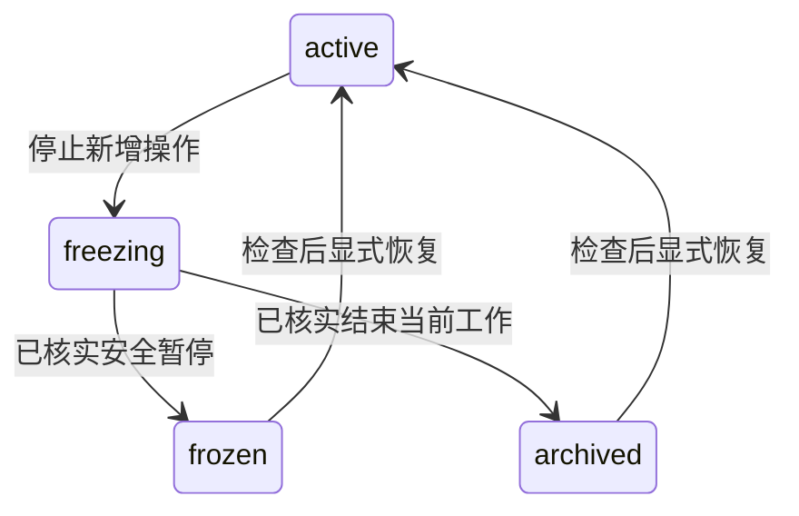

# 多项目管理

一个工作目录承载多个开发目标，每个项目拥有独立记录、源码工作树和生命周期。项目可以包含多个算子及融合优化；子项目编排暂不提供。

## 已提供的入口

- `harness-new-project`：讨论项目目标和名称，建立元数据与计划，准备独立 worktree。
- `harness-onboard`：只读理解已有代码，再接入选定项目；修改前建立独立工作树。
- `harness-archive-project`：停止新增动作，保存检查点，冻结或归档项目。
- `harness-restore-project`：核对源码、依赖与作业后激活项目，不自动启动实验。
- `harness-status`：查看项目或列出简短状态，不取得写入归属。
- 其他执行入口：使用同一项目定位与 owner 约定，不从源码仓库位置推断当前项目。

随 new-project 分发的 `projectctl.py` 提供创建、发现、归属交接、worktree 登记和生命周期检查；随 resume 分发的 `searchctl.py` 按项目隔离搜索树与 hot。完整 CLI、目录、检查点格式和恢复方法统一维护在 [项目管理契约](../../assets/skills/harness-new-project/references/project-management.md)。

## 定位与写入范围

`workspace_root` 是明确选定的工作目录；`project_id` 是稳定目录名；`project_dir` 是 `.workspace/<project_id>`。源码在该目录的 `repos/`，专属依赖源仓库和构建分别放 `sources/`、`builds/`。

安装器只在工作目录安装一次十三项技能，不自动跳到 Git 根。项目名冲突不覆盖，目录不可通过软链接逃逸；没有全局当前项目指针。用户/TASK 显式选择优先，多个项目有歧义时才询问。

项目元数据由工具原子更新，包含当前 owner、生命周期、仓库清单与追加的事件。文件锁保护合作工具的并发操作，不能限制任意 shell/editor；宿主执行者仍需遵守同项目单写入协调者及 TASK 白名单。新会话不得仅凭超时抢占 owner。

工作树创建先保存准备意图，再执行 Git，最后登记实际身份。响应丢失时用原参数核对已有 worktree，不创建第二份或自动删掉冲突目录。未提交的源仓库改动不会自动进入新 worktree。

## 项目契约与交付

[项目契约](../../assets/skills/harness-new-project/references/project-contract.md) 将目标仓库的 API、lint、依赖和测试要求前移到 new-project/onboard。它由 agent 按实际来源填写，已有回答直接复用；未知项只阻塞依赖它的动作，不要求用户逐格填表。

| 记录 | 模板 | 职责 |
| --- | --- | --- |
| PROJECT.md | [项目模板](../../assets/skills/harness-new-project/assets/templates/project.md) | 目标、规范来源、检查计划、必需/诊断证据与授权引用；不重复维护进度或阈值 |
| runs/<run-id>/PRECHECK.md | [预检模板](../../assets/skills/harness-develop/assets/templates/precheck.md) | 正式设备验收前适用低成本检查的实际输入、命令、判定和日志 |
| deliveries/<delivery-id>/DELIVERY.md | [交付模板](../../assets/skills/harness-resume/assets/templates/delivery.md) | 发布版与实测版差异、证据复用/补测/未验证范围及实际发布回执 |

PROJECT 的 draft/ready 只描述计划完整性；TASK 固定契约修订，变更保留旧快照和影响说明。发布前目标 base、源码、依赖或调用路径有变化时重新判断证据适用范围。静态等价不代表新版本已实卡验证，诊断附件缺失也不自动否定已有验收结果。

这些是 skill 执行的检查规则，没有新增自动评测 gate。项目生命周期工具不解析 PROJECT 的自然语言，也不凭 ready 授予推送或合并权限。

## 生命周期

冻结与归档保留路径、源码改动、依赖和构建；默认列表跳过 frozen/archived，明确查看历史时可读取。未知作业、未结算资源或仍在写入的执行者阻止最终关闭。安全暂停的 run 保留检查点，不强制改成终态。

restore 核对关闭检查点、已登记仓库和实际会话归属；skill 继续核实环境、依赖、证据和外部作业。激活只恢复项目可开发状态，automatic 不自动运行，历史精度/性能不自动变为新版本证据。

## 兼容与边界

TASK/RESULT 使用包含 project_id 的 @4 模板，candidate 使用 @2 模板；TASK 明确 workspace_root、project_dir、owner。旧 v1 project_root 的含义不变。旧 `.workspace/STATE.md` 与搜索树显式按 legacy 读取，不自动迁移或改写历史摘要。

共享上板描述在 `.workspace/environments/onboard/<id>/`，项目 ENVIRONMENT.md 绑定确切修订并保留本项目使用约定。配置问询、发布与能力复用遵循 [环境契约](../../assets/skills/harness-prepare-environment/references/environment-contract.md)，目前由 skill 执行；自动环境管理、跨项目额度调度和 simulator 接入仍待建设。

本版不提供完整历史迁移、worktree 搬迁/删除、依赖下载器、环境恢复器、任意文件写入隔离、远端作业探测或后台调度。归档快照不是完整灾备包，忽略文件和二进制依赖仍留在原位。

## 验收范围

CPU 测试使用临时 Git 仓库验证多项目 worktree 隔离、保留脏文件、准备中断恢复、会话冲突、生命周期阻塞、暂停 run 恢复、legacy 只读与独立目录安装。搜索测试验证各项目账本与证据引用隔离、生命周期写入检查和原有幂等/知识修订行为。此类测试不替代外部作业或实卡能力验证。

项目契约的工作流审阅场景：完整规则与匹配的预检可交接设备验收；明确的导入错误先回 develop；发布前 host 调用或依赖能力变化须说明受影响项并补测，未测不得宣称通过；仅缺诊断附件保留限制；已授权推送不重复询问，未授权合并不执行。此类静态审阅与安装检查不等同自动 gate 测试或实卡验证。
