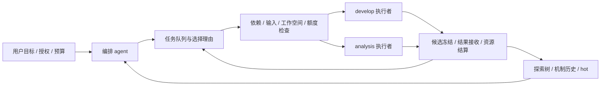

# 自主编排的任务队列与并发工作空间

> **状态：已实现，CPU 集成验证通过。** 使用方式见 [依赖队列契约](../../assets/skills/harness-resume/references/task-queue.md)。远端身份与共享设备锁仍须在目标环境验证。

## 1. 摘要

当前多方案开发已有独立 worktree 和批次登记，但一个未收尾的成员会阻止所有下一阶段任务。编排 agent 因而无法在 A 已完成、B 仍执行时先分析 A，也无法按资源情况逐项补入新的工作。

引入项目内持久任务队列，将“任务能否安全执行”与“现在值得执行哪个任务”分开。程序检查依赖、冻结输入、工作空间独占及预算；编排 agent 决定优先级、并发组合、是否等待整批结果、是否继续某条策略。比较批次保留为关联分组，等待整批成为可显式选择的依赖条件。

主要代价是多个阶段可能同时在途，恢复与证据归属比固定轮次更复杂。通过一个协调 owner、一个账本事实源和冻结候选限制复杂度。

## 2. 背景与范围

当前 [并行开发契约](../../assets/skills/harness-resume/references/parallel-develop.md) 要求每个 develop 独占 worktree、构建及运行目录；`searchctl.Store.develop_batch` 校验已注册的非重叠源码目录、独立 TASK、已接收分析和共同比较输入。普通 run 登记受未结批次、阶段互斥和 current_node 限制。设备作业的启动与互斥由宿主协调者和已绑定环境负责。

本设计覆盖 develop 和 analysis 的队列编排、跨策略运行、候选读取与工作空间生命周期，继续使用现有 run/candidate、验收、预算、job 和知识机制。prepare-environment、establish-baseline、项目冻结等改变共享条件的动作保持维护屏障，不与受影响任务并发。

队列不取代探索树：树表达优化机制及历史，队列表达待执行工作及依赖，run 表达一次实际节点执行。一个搜索节点可以有多个队列项和 run。自动运行的控制批次、用于比较的 develop 分组也分别保留身份，不用同一个 batch_id 推断所有关系。

## 3. 系统关系

编排 agent 是项目唯一写入协调者，管理队列、共享状态与接收。节点执行者只写获准 worktree 和自身 run 产物。队列工具报告可执行条件及拒绝原因，实际派发、作业查询和设备锁仍通过宿主与环境适配完成。

## 4. 设计

### 4.1 一次实际执行

analysis A0 提出两个独立方案 P1、P2。协调者为它们建立策略归属和队列项 Q1、Q2，固定共同父候选及比较契约。存在两个执行槽时，可以分别准入 D1、D2；只有一个槽时按选择顺序执行，排队本身不占 run 步数或工作空间。

D1 先完成。协调者检查全部必交付、接收结果并结算它的作业资源，取得冻结候选 C1。此时可以选择：

- 入队 A1，主候选为 C1，只依赖 D1 的已接收结果；A1 与仍运行的 D2 并存。
- 等待 D2，再以 C1 或 C2 为主候选进行比较分析，读取两份明确结果。
- 若已有证据满足目标，停止新增优化，并按既有约定收尾其他在途任务。

选择及其依据写入队列事件。程序不因 D2 未结束而拒绝 A1，但必须拒绝 A1 读取 D2 尚在变化的候选目录。D2 后来完成不会改变 A1 已冻结的输入；需要纳入它的证据时生成后续分析任务，或在尚未准入的队列项中重新绑定。

### 4.2 队列与编排自主性

队列是有依赖、可调整优先级的任务集合，不要求全局 FIFO。编排 agent 每次选择一个或多个满足条件的任务，记录选择理由，也可选择等待更多证据。`priority` 仅供排序，不能绕过检查。

是否等待所有 develop 由任务的显式依赖表达。要比较指定分组的完整结果时，依赖该组固定成员的 settled 状态；只分析某个候选时，依赖产生它的 accepted 结果。后续新增方案另建队列项/分组，不扩张已经冻结的“等全部”成员集合。

不设固定“每个 develop 必须跟一个 analysis”或“全批只能有一个 analysis”。每次分析仍绑定一个主候选、一个搜索节点及具体问题，允许引用多个可比较的冻结结果。重复分析相同输入、问题和证据而没有新依据时，协调者应复用已有结论；工具只检查精确重复身份，不承担语义判重。

现有 current_node 在新调度模式中仅表示导航焦点，TASK 的 search_node_id 决定执行归属。切换导航不修改在途任务。关闭/停放策略节点只检查关联的在途任务及资源，不因别的策略运行而全局阻塞。

### 4.3 准入与派发

入队只记录意图，允许依赖尚未完成。执行前完成输入解析和冻结：从已接收 run 明确选出 candidate_id，核对 case/协议/环境、分析方案适用性，再生成不可变 TASK 和评测计划。一个 run 产生多个尝试时，必须选定一个候选，不能默取最新目录。

协调者提交准入操作时，工具在同一原子更新中复核队列项修订、依赖摘要、可用执行槽与工作空间占用，登记 run、建立 queue-item→run 关系，并按现有 control 占一步。准入后使用稳定的派发 request ID 保存意图，再启动 agent。设备预留和 job 记录仍在真正设备动作前按现有 control 执行；占一个 agent 槽不授予设备使用权。

TASK/计划文件在原子登记前写入专属预备目录并固定摘要。登记失败的文件属于未派发准备产物，可以按原 ID 重试；不能凭文件存在推定已派发。响应丢失先检查账本和原 request，避免重复占步或启动。

### 4.4 工作空间归属

可写工作空间绑定一个在途 develop run，包括 repo_id/worktree/branch、本地与远端源码、build/JIT/cache 和输出目录。并行 develop 可以来自相同父候选、不同父候选或不同搜索方向；各自完整恢复输入源码快照，包括补丁与未跟踪文件。是否允许性能横向比较由比较契约决定。

| 资源 | 归属与使用 |
| --- | --- |
| 工作源码、可变依赖与构建缓存 | 一个活动 run 独占；路径重叠或别名映射到同一资源时拒绝同时准入 |
| 共享依赖/工具链安装 | 只读；需要修改时另行隔离，变更共享安装走维护屏障 |
| 冻结候选与已接收证据 | 可供多个 analysis/verify 读取；不得依赖将被复用的工作目录 |
| analysis 临时输出 | 自己的 run 目录；需要编译/仿真的分析另申请可写构建区与资源 |
| 设备 | 使用实际物理设备与环境的共享锁/队列；同卡性能测量串行 |

worktree 不是不可变快照。analysis 从候选清单恢复只读视图或读取内容固定的源码包；只引用分支名、活动路径或可变 HEAD 不满足要求。正式证据保留 commit/补丁、依赖与构建身份，不随 worktree 释放而消失。

run 接收或安全关闭后，核对 agent/远端 writer 已停止、job 终态、冻结产物可独立重建，才释放独占占用。先收尾的 worktree 可以独立复用，不等待无关成员。复用建立新占用代次并清楚记录新父候选；保留旧未提交内容快照，不自动清理或重置含未知改动的目录。

Git worktree 共享部分仓库元数据，因此执行者不能修改共享 Git 配置、其他分支或兄弟工作区。路径校验是协作约束，不宣称构成任意 shell 的安全沙箱。

### 4.5 接收、比较与知识

成员可乱序接收，候选晋升仍单独执行。输入候选和比较契约在准入后固定；其他任务产生新的 best 不会自动重设在途任务的父候选或测量分母。不同契约的结果可供定性分析，不能直接排名或覆盖 best。

组合两个方案需要明确主父候选和另一候选的改动来源，产生新 develop 和新候选，重新验证。读取两份结果不会合并它们的搜索归属、候选谱系或通过状态。

analysis 的新发现按实际适用节点进入 hot；失效与反例保留历史。队列条目本身不是知识结论，不改变 cooled 的人工批准要求。

## 5. 不变式与要求

- **INV-1**：一个项目只有一个有效写入 owner；队列、run、占用和控制步数的准入更新原子提交。
- **INV-2**：一个队列项最多绑定一个 run；同事件重试不重复登记、占步或派发。
- **INV-3**：执行 TASK 使用固定候选与证据摘要，不读取其他在途 writer 的可变输出。
- **INV-4**：可写目录和资源占用不重叠；未知 writer/job 保持其相关占用。
- **INV-5**：analysis/develop 的精度、性能、实现归因与接收标准保持原契约。
- **INV-6**：无关任务未完成不构成全局屏障；显式依赖、共享资源或维护动作可以阻止准入。
- **INV-7**：新任务占步和设备额度只在对应准入/预留时发生，排队、重连和重新排序不重复消耗。
- **INV-8**：用户暂停、范围、授权与项目生命周期优先于队列选择；unknown 不自动释放或重投。

每次结果接收、关闭、资源状态变化或用户新决定后刷新就绪条件。每次调度决定保留被选项与相关未选项的原因；被长期延后的工作在 status 中可见，不以无法证明的“最终都会执行”作保证。公平性是编排策略，本设计不强制 FIFO 或固定轮转。

## 6. 接口与数据

### 6.1 单一事实源与版本

使用 `operator-harness/search@2`，在同一 search/tree.json 中保存 scheduling 扩展，继续通过 searchctl 与已有 owner 锁修改。显式版本升级保证旧工具拒绝写入新语义，防止绕过依赖或并发占用检查。STATE/AUTOMATIC 只保存队列引用和事件水位，不复制可编辑队列。

现有 search@1 项目继续遵守旧屏障。在无在途 run/job、资源已结算的安全边界，可由协调者显式启用新模式；不自动迁移运行中的批次。升级保留全部历史 run、候选、接收和摘要，不补造旧队列项，也不改变旧验收资格。启用后旧工具不得写新树；有新调度事件后不通过简单删字段降级，保留原账本用于恢复。

### 6.2 队列项

以下为数据语义，具体 CLI 字段见依赖队列契约；searchctl 校验身份、字段、依赖拓扑与准入条件：

| 字段组 | 内容 |
| --- | --- |
| 身份 | project_id、queue_item_id、revision、stage、operation、search_node_id、plan_id/mechanism_id（适用时） |
| 目的与输入 | 待回答问题/实施范围、输入候选或等待某个 run 输出的绑定要求、输入引用与摘要、analysis_run |
| 依赖 | `requires`：run ID + `accepted` 或 `settled`；后者仅表示已接收或安全关闭，不表示正确性通过 |
| 分组 | 可选 comparison_group_id；固定成员清单与共同比较契约，身份区别于 automatic 控制批次 |
| 选择 | 优先级提示、选择/延后原因、决策依据、明确设置的等待条件 |
| 需求 | 执行槽、所需工作空间类别、设备/仿真与预算需求；未准入时不等于已占用 |
| 生命周期 | queued / admitted / cancelled；run_id、supersedes、取消或替代原因 |

依赖只引用已登记 run，想等待尚未准入的任务时引用 queue_item_id，准入后解析为其唯一 run；两类引用都校验项目、存在性与无环。取消/关闭的前序不满足 accepted 依赖；settled 可满足收尾条件，但不能据此选择失败候选进行普通优化。

针对 queue_item_id 的 settled 条件，也允许该项在准入前明确 cancelled：汇总时记为 cancelled/not_run，不生成 run、候选或测试结果。accepted 条件继续阻塞并显示前序取消原因，协调者需取消后继或修订尚未准入的依赖，不能自动替换为其他候选。

`ready/blocked/accepted/closed` 视图从依赖、绑定 run 和资源实时推导，不再独立维护另一套执行状态。queued 项修改使用修订比较；admitted 项不可改输入或范围，需要新任务时沿用安全关闭/后继流程。取消未准入项不占 run 步数；准入后的取消是原 run 的收尾。

对失败材料的分析必须显式标为失败诊断，绑定冻结反例与确切候选；它不以失败 develop 充当正常已接收输入。所有方案都失败时，编排 agent 可以安排这种诊断，不需要伪造一个成功候选解锁队列。

### 6.3 操作

| 操作 | 语义 |
| --- | --- |
| enqueue / revise / cancel | 增加或修订未准入项；校验依赖循环和身份；取消保留原因 |
| ready / show / reconcile | 只读展示依赖、阻塞、在途 run、占用与漂移，不自动选方案 |
| admit | 编排 agent 选择后原子登记 run、控制步数与工作空间占用；返回稳定派发身份 |
| accept / close-run | 沿用现有 gate 与结算要求；更新相关队列投影，唤醒受影响依赖 |
| release-workspace | 仅在 writer/job 与可重建快照核对完成后释放；记录代次防止旧执行者写入复用目录 |

每项写操作沿用唯一 event_id、owner、文件锁和摘要检查。queue/run/candidate/group ID 独立、项目内唯一，重复 ID 内容冲突报错，不通过改名默建第二份工作。新 TASK 绑定 queue_item_id 与已解析依赖快照；节点产物继续使用既有 RESULT/候选契约，新增调度校验不重新定义测量证据。

### 6.4 资源身份

本地源码按解析后的真实目录检查重叠；远端资源以环境中的机器/容器/挂载身份和实际目录标识，不仅比较字符串路径。设备以环境验证的物理资源 ID 标识，避免两个逻辑编号绕过互斥。资源身份无法确定时阻止相关动作，其他独立任务仍可执行。

项目 control 继续记录预算，宿主共享设备队列负责跨任务/跨项目互斥，不建立第二份设备余额。工作空间占用记录只是新增的写入独占关系。拿不到设备时任务保留原 run 等待；不重建 run 或反复计步。执行槽默认沿用已有并发配置，analysis 同样计入宿主总槽位；需要调整时按现有资源约定执行。

## 7. 失败与生命周期

| 事件 | 行为 |
| --- | --- |
| 前序精度/实现失败 | 原 develop 在预算内修复；后继 accepted 依赖保持阻塞。安全关闭后可显式安排失败诊断 |
| 成员长期阻塞 | 编排 agent 按任务等待/资源上限决定等待、关闭或取消；不会因到时自动伪造完成 |
| 一项 SHA256/身份漂移 | 阻止依赖它的新动作并报告影响；无关任务可继续，已冻结在途输入不被替换 |
| 派发响应丢失 | 查询原 request/agent/job，保持原占用；不再次启动 |
| 协调者中断或接管 | 先核对 owner 和现有 writer，再恢复队列、run、派发意图与资源，不重新占步 |
| 已接收后占用释放中断 | 接收事实保留；恢复仅补核对和释放，不能重新执行候选 |
| 某 analysis 发现新反例 | 标记受影响证据与依赖需复查；协调者审查相关候选/晋升，保留历史记录 |
| 用户暂停 / next / 归档 | 暂停新增准入；next 绑定一个明确动作，收尾与恢复沿用当前模式语义；归档等待所有 writer/job 收尾 |
| 共享环境或目标契约变更 | 先识别影响任务，在维护屏障收尾后生成新修订；在途 TASK 不热替换 |

启动时坏账本不自动修复，保留可读历史和资源查询入口。多项故障同时存在时，先确认 writer/job 与资源归属，再处理依赖和输入错误。未知工作只阻塞其关联资源和后继；owner 无法确认或全局契约漂移时停止项目新派发。

## 8. 权限、私密信息与运行限制

沿用项目 owner、节点白名单及环境授权；排队和高优先级不扩大权限。状态/路径/日志属于数据，不能自动执行其中的命令文本。机器地址、目录、版本、设备测量和资源记录保存在私有运行目录；产品模板只表达通用契约。

队列默认不预建所有 worktree。实际准入才占用空间和槽位；磁盘、CPU、内存、编译、设备及仿真受既有上限限制，耗尽后保留待办和阻塞原因。工具不自动终止其他任务或清理未知目录。

## 9. 验收条件

- **AC-1**：D1 已接收、D2 运行中，输入和资源独立的 A1 能准入；D2 的记录不变。
- **AC-2**：声明依赖 D1/D2 settled 的 A2，在任一未收尾时拒绝准入；两者收尾后可执行，关闭结果仍显示失败/未验证。
- **AC-3**：两个 develop 独立恢复同一父候选，在不同 worktree 编译修改；重叠本地/远端目录被拒绝。
- **AC-4**：analysis 读取冻结 C1 时，原 worktree 被安全复用不改变其输入；引用活动工作目录时拒绝准入。
- **AC-5**：两个同时准入请求竞争同一槽/工作空间时最多一个成功；重复 event/request 不重复占步或派发。
- **AC-6**：乱序接收、关闭、暂停和重连保留全部队列/run 关系；unknown 相关占用不释放。
- **AC-7**：同设备计时请求按资源约定串行，离线 analysis 可与设备运行并存。
- **AC-8**：旧 search@1 在途批次保持旧规则；新模式启用后旧写入工具被版本拒绝。
- **AC-9**：比较分组成员、父候选及验收输入不会随新增 best/新方案改变；组合候选必须新验。
- **AC-10**：取消前序、循环依赖、失效证据和预算不足均显示精确阻塞；无关 ready 项可被选择。

## 10. 验证方法

账本测试覆盖准入原子性、重复请求、依赖环、修订冲突、分组条件与版本升级（INV-1/2/6/7，AC-1/2/5/8/10）。隔离临时 Git 仓库验证补丁/未跟踪文件快照、跨 worktree 写入冲突和冻结读者（INV-3/4，AC-3/4/9）。假宿主验证派发失联、乱序完成、占用释放中断和暂停恢复（INV-2/4/8，AC-5/6）。

设备队列用假适配器验证互斥，再在已授权环境验证实际锁与物理设备映射（INV-4/7，AC-7）。原验收回归继续覆盖精度、思路归因及候选晋升（INV-5，AC-9）。CPU 测试不替代远端目录/设备互斥的实际验证。

## 11. 风险与取舍

提前分析可能在其他结果到达后需要补充，因此每个 analysis 固定所回答的问题与输入集合，协调者按预期收益选择是否等待。新版本允许更多交错状态，以明确依赖和原子准入代替全局屏障，代价是需要更完整的恢复测试。

任意 shell 无法由路径登记完全隔离，宿主仍须落实写入白名单及共享资源约定。多个项目共享设备时依赖现有宿主锁，不能仅靠项目内 JSON 宣称跨项目安全。

## 12. 未决项

无阻塞设计方向的用户问题。建议默认沿用当前宿主并发配置，comparison_group 只作比较关联，等待全组由显式依赖决定；不设置固定轮次和固定队列长度。CLI 字段与资源证据格式已在依赖队列契约固定；真实远端资源身份与跨项目设备锁由目标环境核实。

## 13. 不在范围内

独立后台调度服务、跨项目统一优先级调度、MCTS/自动机制评分、未完成候选的推测执行、自动合并代码和绕过失败接收。develop 的能力资料增强另见 [开发能力设计](../develop-capabilities/design.md)。
