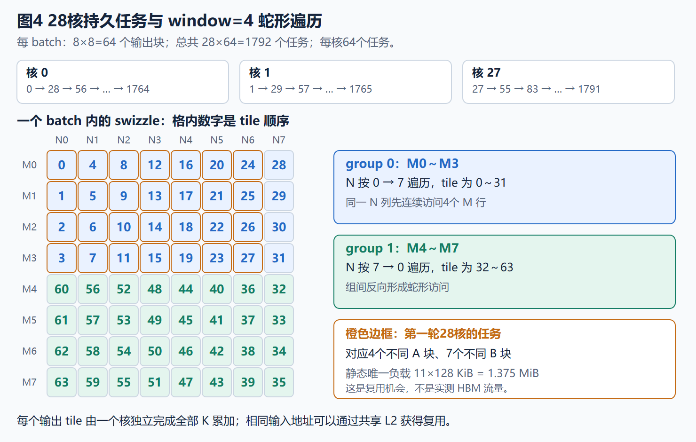

# Batch GEMM 实现逐项解读

## 本文解读的文件

- **仓库**：`tilelang-mlir-ascend`
- **所在分支**：`harness`
- **算子源码的仓库内路径**：[`example/gemm/example_batch_gemm.py`](example_batch_gemm.py)
- **本文的仓库内路径**：`example/gemm/Batch_GEMM_实现逐项解读.md`
- **配图目录**：`example/gemm/batch_gemm_figures/`

以下代码片段、tile 参数、缓冲容量、流水及任务分配说明均针对上述 `example/gemm/example_batch_gemm.py`。

## 1. 算子规格与固定配置

计算定义为：
```text
C[b, m, n] = Σk A[b, m, k] × B[b, n, k]
```

| 项目 | 当前设置 |
| --- | --- |
| 默认形状 | batch=28，M=N=K=2048 |
| A 布局 | 连续 ND，`[batch, M, K]` |
| B 布局 | 连续 ND，`[batch, N, K]` |
| 输入类型 | BF16 |
| 累加与输出类型 | FP32 |
| C 布局 | `[batch, M, N]` |
| 后端 | Ascend C，`target="ascend"` |
| 主机调用后端 | `execution_backend="tvm_ffi"` |
| 功能边界 | 无 bias、激活、batch 广播或尾块处理 |

B 的输入本身就是 NK 布局。数学上计算 `A @ B.T`，不代表代码在主机或 GM 中额外生成了一份转置矩阵。

kernel 使用以下主要配置：

```python
batch_m, batch_n, batch_k = 256, 256, 256
l0_k = 64
stages = 2
prefetch = True
window = 4
split_m = 1
dtype, out_dtype = "bfloat16", "float32"
uf_partial, uf_final = 2, 3
```

当前只按 BF16→FP32 解读。不能把历史版本出现过的 FP16，或后续想支持的 FP8，列成这份实现已经具备的能力。

## 2. 总体数据通路


```text
A：GM [256,256] → L1 A 双槽 → L0A [256,64] 双槽 ┐
                                                  ├→ Cube → L0C [256,256] FP32 → GM C
B：GM [256,256] → L1 B 双槽 → L0B [256,64] 双槽 ┘
```

这里有三种不同的粒度：

1. **输出任务粒度**：一个任务负责一个 `256×256` 的 C 块。
2. **L1 搬运粒度**：一次为该输出块准备 K 方向256个元素的 A/B 数据。
3. **Cube 计算粒度**：每次使用 K 方向64个元素，执行 `256×256×64` 的矩阵乘累加。

因此，`batch_k=256` 与 `l0_k=64` 各自控制不同层级，不应合并成同一个参数。

## 3. tile 如何选择


### 3.1 先按字节计算容量，再考虑性能

BF16 每个元素2字节，FP32 每个元素4字节。双缓冲必须把两份数据都计入容量。

| 缓冲 | 单槽形状 | 单槽容量 | 槽数 | 总容量 |
| --- | --- | ---: | ---: | ---: |
| L1 A | `256×256` BF16 | 128 KiB | 2 | 256 KiB |
| L1 B | `256×256` BF16 | 128 KiB | 2 | 256 KiB |
| L0A | `256×64` BF16 | 32 KiB | 2 | 64 KiB |
| L0B | `256×64` BF16 | 32 KiB | 2 | 64 KiB |
| L0C | `256×256` FP32 | 256 KiB | 1 | 256 KiB |

L1 A/B 总占用为512 KiB。表中是当前 tile 和生成槽布局的容量核算，不是把所有架构的 L1 容量统一假定为512 KiB。

### 3.2 为什么 L0 K 选择64

按照本例采用的 L0A/L0B 各64 KiB容量约束，双缓冲后每槽预算为32 KiB：

```text
L0A 单槽：M_tile × K_tile × 2 ≤ 32 KiB
L0B 单槽：N_tile × K_tile × 2 ≤ 32 KiB
```

当 `M_tile=N_tile=256` 时：

```text
K_tile ≤ 32768 / (256×2) = 64
```

所以 `256×64` 恰好对应一个32 KiB槽。L0A 和 L0B 各有两个这样的槽。

这说明64是当前 M/N 分块及双缓冲约束下的自然选择，不意味着其他 M/N 分块也必须使用64。

### 3.3 为什么输出块选择256×256

一个 `256×256` FP32 累加块占用：

```text
256 × 256 × 4 = 262144 bytes = 256 KiB
```

当前把 L0C 用于一个较大的输出块。较大的 M/N 块提高一次输入加载所服务的计算量，并减少整个矩阵的输出任务数量。

但占满 L0C 只说明空间占用，不能证明计算单元的时间利用率已经达到100%。

### 3.4 为什么 L1 K 选择256，而不是64

L1 K=256 时，一个 A 块和一个 B 块分别为128 KiB。搬入后可以分成4个 L0 K 子块使用：

```python
l0_tiles = batch_k // l0_k  # 256 // 64 = 4
```

它把较大的 GM 搬运粒度与较小的 Cube 计算粒度分开，目标是减少细碎搬运和相应控制开销，并为分级流水提供空间。

这仍是容量、搬运效率与流水深度之间的选择，不能在没有同协议实验时宣称256对所有 shape 最优。

### 3.5 与128×128×128的比较

若使用 `128×128×128` 作为 L0 计算 tile：

| 项目 | 当前256×256×64 | 对照128×128×128 |
| --- | ---: | ---: |
| L0A 单槽 | 32 KiB | 32 KiB |
| L0B 单槽 | 32 KiB | 32 KiB |
| 一个 FP32 输出块 | 256 KiB | 64 KiB |
| 2048²矩阵的输出块数 | 64 | 256 |
| 每个输出块覆盖2048 K所需的计算子步 | 32 | 16 |
| 整个2048³矩阵的计算子步总数 | 2048 | 4096 |

最后一行按所列 tile 直接分解计算，是理论计数，不是新编译结果或实测耗时。

128方案同样能满足输入双缓冲容量，但输出块数更多，任务、指令和输入重复加载的取舍也不同。不能只看单个 K 子块更大，就判断它更快。

## 4. 双缓冲究竟开在哪里

代码通过以下声明为四个输入缓冲设置两个版本：

```python
T.annotate_buffer_versions({
    lhs: stages,
    rhs: stages,
    lhs_l0: stages,
    rhs_l0: stages,
})
```

| 对象 | 当前状态 | 用途 |
| --- | --- | --- |
| L1 A/B | 各两个槽 | 为 K 方向搬运与后续计算交替使用 |
| L0A/L0B | 各两个槽 | 为 L1→L0 搬运与 Cube 消费交替使用 |
| L0C | 单累加块 | 保留一个输出 tile 的完整 K 方向累加结果 |

**L0A、L0B 的两个子槽都在生成代码中使用；当前没有跨输出 tile 的 L0C 双缓冲。**

保留的 CCE 中，L0A/L0B 都有类似偏移：

```cpp
lhs_l0 + ((sub & 1) * 16384)
rhs_l0 + ((sub & 1) * 16384)
```

这里的16384是 BF16 元素数，对应32768字节，即32 KiB。

默认2048形状下，L1 槽偏移可见：

```cpp
(kt & 1) * 65536
```

65536个 BF16 元素对应128 KiB。A/B 地址还包含各自的基址，需一起核对，不能只看到一个取模表达式就推断所有缓冲都正确分配了双槽。

双槽允许生产者与消费者交错工作。它是否实际消除了等待，还需要看流水，不能只凭源码声明下结论。

## 5. K 方向预取与两级流水


### 5.1 外层：GM→L1 与计算阶段分开

代码骨架为：

```python
for kt in T.Pipelined(
    k_tiles,
    num_stages=stages,
    annotations={"enable_offset": prefetch},
):
    with T.Stage(0):
        T.copy(A[batch_id, row, kt * batch_k], lhs)
        T.copy(B[batch_id, col, kt * batch_k], rhs)

    with T.Stage(stages - 1):
        # L1→L0 与 Cube 运算
        ...
```

`stages=2` 时，Stage0负责输入搬运，Stage1负责消费已准备的数据。`prefetch=True` 打开相应的 offset 调度选项，配合双缓冲组织预取。

这是源码表达的流水意图。真实指令顺序、序言和排空应以生成代码为准。

### 5.2 内层：L0 双槽供给 Cube

```python
for sub in T.Pipelined(l0_tiles, num_stages=stages):
    T.copy(rhs[:, sub * l0_k : (sub + 1) * l0_k], rhs_l0)
    T.copy(lhs[:, sub * l0_k : (sub + 1) * l0_k], lhs_l0)
    T.gemm(lhs_l0, rhs_l0, acc, transpose_B=True, ...)
```

每个 L1 K 块被切成4份，每份用于一次 `256×256×64` 的计算。生成代码根据子步切换 L0A/L0B 的槽，并插入搬运与计算之间的事件。

默认 K=2048 时：

```text
有效 L1 K 块：2048 / 256 = 8
每块 L0 子步：256 / 64 = 4
每个输出 tile：8 × 4 = 32 次矩阵乘累加
```

生成代码可能出现9次外层循环，其中包含流水序言和排空；不能把循环上界直接当作9个有效 K 块。

## 6. FP32累加与输出策略

代码只为一个输出块分配一个累加器：

```python
acc = T.alloc_l0c((tile_m, batch_n), out_dtype)
```

第一次 K 子步初始化累加器，后续子步继续累加：

```python
clear_accum = (kt == 0) & (sub == 0)
```

完整 K 方向计算结束后，才写回最终结果：

```python
T.copy(acc, C[batch_id, row, col], unit_flag_ctrl=uf_final)
```

这样避免了每个 K 块都把部分和写到 GM，再读回来继续计算。当前没有部分和 GM 缓冲，也没有 Split-K 规约阶段。

## 7. Cube/Fixpipe 的 UnitFlag 协议

当前设置：

```python
uf_partial, uf_final = 2, 3
```

矩阵乘根据是否为最后一个有效 K 子步选择标记：

```python
unit_flag_ctrl = T.Select(
    (kt == k_tiles - 1) & (sub == l0_tiles - 1),
    uf_final,
    uf_partial,
)
```

最终输出使用相匹配的标记：

```python
T.copy(acc, C[batch_id, row, col], unit_flag_ctrl=uf_final)
```

在本实现和所用后端中，中间 MMAD 使用2，最后 MMAD 使用3，最终 Fixpipe copy 使用3。目的是让 Cube/Fixpipe 交接通过匹配的硬件协议表达，减少相应的软件事件。

保留的生成代码中可以核对：

```text
asc_mmad(..., 最后子步 ? 3 : 2, ...)
asc_copy_l0c2gm(..., asc_unit_flag_mode(3), ...)
```

这不是“去掉所有同步”。L1槽和L0槽的复用仍需要 MTE2、MTE1、Cube 之间的依赖。更换累加器数量、输出顺序或缓冲槽时，必须重新检查 producer/consumer 配对，不能机械沿用2和3。

## 8. 28核持久任务分配

首先计算输出任务总数：

```python
m_tiles = M // batch_m
n_tiles = N // batch_n
tiles_per_batch = m_tiles * n_tiles
tiles = batch * tiles_per_batch
```

默认形状对应：

```text
每个 batch：8 × 8 = 64 个输出 tile
总任务数：28 × 64 = 1792
平均每核：1792 / 28 = 64 个输出 tile
```

分配入口为：

```python
with T.Kernel(cores) as cid:
    for tile_id in T.Persistent([tiles], cores, cid, num_stages=stages):
        batch_id = tile_id // tiles_per_batch
        tile = tile_id % tiles_per_batch
```

默认生成代码对应每核按步长28领取后续任务，可以理解为：

```text
tile_id = cid + iteration × 28
```

一个 batch 的64个输出块因此分散到多个核。每个输出块仍由单核独立完成全部 K 方向计算，不需要跨核合并部分和。

这里的“持久”表示一个 kernel 内的核循环领取多个任务，不表示整个 batch 的 A/B 被永久保留在片上。

## 9. window=4 的蛇形 swizzle




核心索引为：

```python
group = tile // (n_tiles * window)
in_window = tile % (n_tiles * window)
row = (group * window + in_window % window) * batch_m
col_tile = in_window // window
col = T.Select(group % 2 == 0, col_tile, n_tiles - 1 - col_tile) * batch_n
```

默认有8个 M tile、8个 N tile。一个窗口包含4行 M tile与全部8列 N tile：

```text
第0组：M行0～3，N列按0→7遍历
第1组：M行4～7，N列按7→0遍历
```

窗口内部先变化 M，再变化 N。例如前几个输出块坐标是：

```text
(m_tile,n_tile) = (0,0),(1,0),(2,0),(3,0),(0,1),(1,1),...
```

这样的顺序让近时任务有机会使用相同的 B 分块，同时保留一定的 A 复用机会。跨核复用可以通过共享 L2 发生，不要求这些任务都在同一个核上执行。

但源码没有把跨输出 tile 的 B 显式保留在 L1。swizzle 提供的是地址与时间顺序上的复用机会，收益还取决于缓存容量、调度和实际事务。

当前源代码固定 `window=4`。默认2048尺寸满足完整窗口；512尺寸只有2个 M tile，不能直接沿用这一映射。历史512仿真使用过测试专用的窗口适配，不能据此宣称当前固定窗口源码直接支持512³。

## 10. 跨核任务如何利用共享L2

默认第一轮28个核处理同一 batch 的前28个输出 tile。按 `window=4` 的映射，第一个 K 搬运块对应4个不同的A块和7个不同的B块：

```text
唯一输入块数 = 4 + 7 = 11
每块大小     = 256 × 256 × 2 = 128 KiB
唯一输入负载 = 11 × 128 KiB = 1.375 MiB
```

多个核会请求其中相同的输入地址，因此共享 L2 有机会服务重复读取。这是任务排序产生的复用机会，不是源码显式维护的跨核共享 L1 缓冲。

上述1.375 MiB是这一轮的静态唯一地址负载，不是实测 HBM 流量；它也不代表整个 kernel 只需要读取这些数据。

一个 B 输出列面板覆盖完整 K，需要：

```text
256 × 2048 × 2 = 1 MiB
```

当前 B 的 L1 双槽总共256 KiB，按 K 块轮换，无法把这个完整面板一直留在当前双槽中。因而需要区分三件事：L1 中一块数据被多个 L0 子步消费、不同输出任务重复请求相同 GM 地址、重复请求是否真正命中 L2。

实际收益需由 L2 事务、MTE2等待、Cube空泡和全核长尾验证，不能直接把唯一地址负载的减少换算为加速倍数。

## 11. 哪些机制已经开启，哪些没有

| 机制 | 当前状态 | 判断依据 |
| --- | --- | --- |
| L1 K与L0 K分级 | 已开启 | `batch_k=256`、`l0_k=64` |
| L1 A/B双缓冲 | 已开启 | buffer versions与CCE槽偏移 |
| L0A双缓冲 | 已开启 | CCE的两个32 KiB槽 |
| L0B双缓冲 | 已开启 | CCE的两个32 KiB槽 |
| K方向预取 | 已配置 | `enable_offset=True`及生成调度；实际覆盖程度看流水 |
| 分阶段流水 | 已开启 | Stage0/Stage1与内外层Pipelined |
| FP32部分和片上累加 | 已开启 | 单L0C累加器，完整K结束后写回 |
| Cube/Fixpipe UnitFlag | 已开启 | 中间2、最后3、输出3 |
| 持久任务循环 | 已开启 | 使用`T.Persistent`分配输出任务 |
| 蛇形swizzle | 已开启 | `window=4`与group奇偶选择 |
| split-M=2 | 未开启 | 当前固定`split_m=1` |
| 跨输出tile的L0C双缓冲 | 未开启 | 当前仅一个256×256累加块 |
| 跨输出tile显式L1常驻复用 | 未开启 | 每个输出任务仍重新执行A/B搬运 |
| Split-K及跨核部分和规约 | 未开启 | 每个输出tile在单核完成完整K |

## 12. 代码证据与性能结论的边界

### 12.1 当前快照已有的正确性记录

本实现保留的正确性记录覆盖 `B=2、M=1024、N=256、K=512` BF16→FP32模型执行，全输出比较通过、最大误差0。

该次调用发起28核；小尺寸下部分核没有有效输出任务。记录中的48秒是仿真的主机执行墙钟时间，不是 kernel 设备耗时，不能用于计算 MFU。

### 12.2 主机入口的实际行为

`main` 默认使用固定seed生成有符号整数再转换为BF16并除以8，参考为CPU FP32 `A @ B.T`。默认执行用于正确性检查，不自动输出设备性能。

当前源码通过 `out_idx=-1` 自动分配输出，没有预填NaN。若后续补充输出覆盖检查，应在独立验证入口预填NaN并检查完整输出；该验证机制尚未包含在当前源码中。

本实现没有自动执行统一的10次预热。任何后续性能采集都应明确记录实际预热、采样数量和设备计时范围。

### 12.3 MFU

950PR、28核上板时间为1372μs。对应 `B=28、M=N=K=2048` 的完整BF16 kernel，则：
```text
有效FLOPs = 2 × B × M × N × K
          = 481036337152

吞吐量 = 有效FLOPs / 1372μs ≈ 350.61 TFLOP/s
MFU    = 吞吐量 / 378 TFLOP/s ≈ 92.75%
```

这里统一采用28核名义峰值378 TFLOP/s。