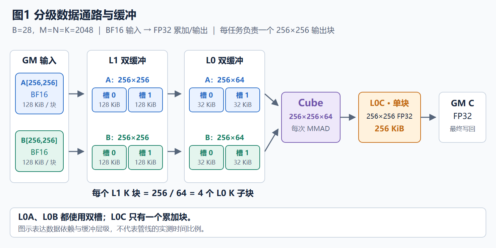
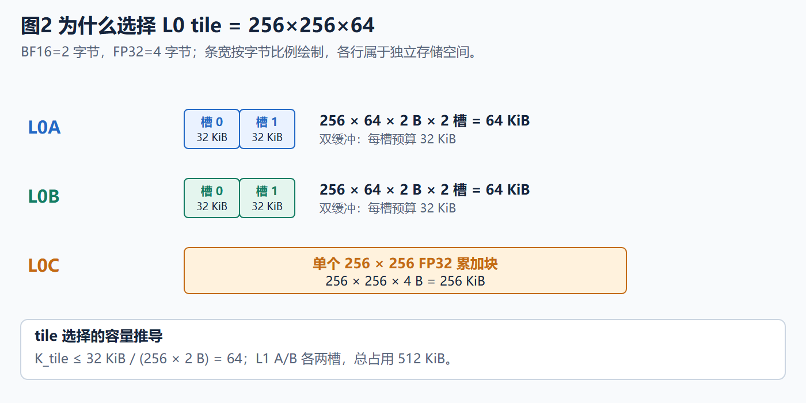
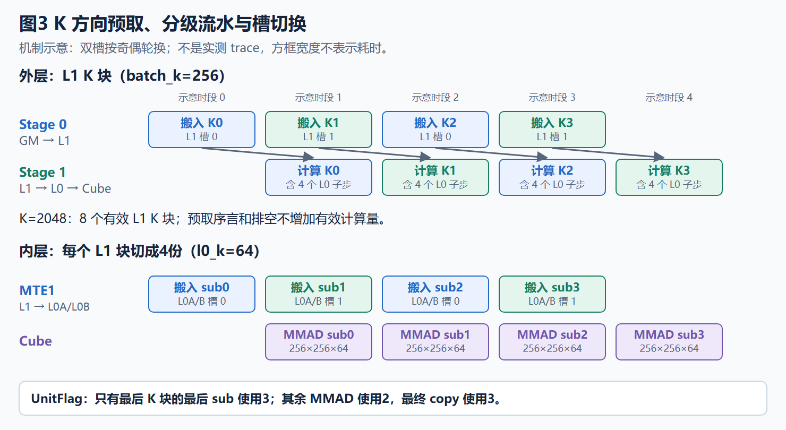

# Batch GEMM 实现逐项解读

## 本文解读的文件

- **仓库**：`tilelang-mlir-ascend`
- **所在分支**：`harness`
- **算子源码的仓库内路径**：[`example/gemm/example_batch_gemm.py`](example_batch_gemm.py)
- **本文的仓库内路径**：`example/gemm/Batch_GEMM_实现逐项解读.md`
- **配图目录**：`example/gemm/batch_gemm_figures/`

以下代码片段、tile 参数、缓冲容量、流水及任务分配说明均针对上述 `example/gemm/example_batch_gemm.py`。

本文按“源码表达 → 执行原理 → 带来的好处 → 生效条件”展开。图1用于定位数据所在的存储层级，图2用于计算容量，图3用于理解生产者与消费者的交错，图4用于理解任务顺序。图中的时间方框不是实测 trace，理论计数也不等于已经测得的加速比。

## 1. 算子规格与固定配置

计算定义为：

```text
C[b, m, n] = Σk A[b, m, k] × B[b, n, k]
```

| 项目 | 当前设置 |
| --- | --- |
| 默认形状 | batch=28，M=N=K=2048 |
| A 布局 | 连续 ND，`[batch, M, K]` |
| B 布局 | 连续 ND，`[batch, N, K]` |
| 输入类型 | BF16 |
| 累加与输出类型 | FP32 |
| C 布局 | `[batch, M, N]` |
| 后端 | Ascend C，`target="ascend"` |
| 主机调用后端 | `execution_backend="tvm_ffi"` |
| 功能边界 | 无 bias、激活、batch 广播或尾块处理 |

B 的输入本身就是 NK 布局。数学上计算 `A @ B.T`，不代表代码在主机或 GM 中额外生成了一份转置矩阵。

### 1.1 BNK布局为什么适合这里的搬运

在连续的 `[batch,N,K]` 中，固定 `batch_id` 和 `n` 后，K方向元素的地址连续。因此一个 `B[col:col+256, kt*256:(kt+1)*256]` 块由256段连续的K数据组成，每段256个BF16元素。A的对应块也沿K连续，输入的两侧可以使用相似的分块方式。

`transpose_B=True` 告诉矩阵乘接口，右侧缓冲保存的是 `N_tile×K_tile`，计算时按其转置参与乘法。它改变的是矩阵乘的解释方式；ND到片上计算布局的组织仍由相应搬运与编译生成代码完成。

**好处**：当上游已经提供BNK数据时，这个kernel不需要额外启动一个完整矩阵转置kernel，也不需要为其分配一份GM临时矩阵。若实际调用方提供的是BKN，布局转换成本仍然存在，比较端到端性能时必须计入，不能归到本例之外后再宣称整体加速。

kernel 使用以下主要配置：

```python
batch_m, batch_n, batch_k = 256, 256, 256
l0_k = 64
stages = 2
prefetch = True
window = 4
split_m = 1
dtype, out_dtype = "bfloat16", "float32"
uf_partial, uf_final = 2, 3
```

当前只按 BF16→FP32 解读。不能把历史版本出现过的 FP16，或后续想支持的 FP8，列成这份实现已经具备的能力。

## 2. 总体数据通路




```text
A：GM [256,256] → L1 A 双槽 → L0A [256,64] 双槽 ┐
                                                  ├→ Cube → L0C [256,256] FP32 → GM C
B：GM [256,256] → L1 B 双槽 → L0B [256,64] 双槽 ┘
```

这里有三种不同的粒度：

1. **输出任务粒度**：一个任务负责一个 `256×256` 的 C 块。
2. **L1 搬运粒度**：一次为该输出块准备 K 方向256个元素的 A/B 数据。
3. **Cube 计算粒度**：每次使用 K 方向64个元素，执行 `256×256×64` 的矩阵乘累加。

因此，`batch_k=256` 与 `l0_k=64` 各自控制不同层级，不应合并成同一个参数。

### 2.1 跟踪一个输出元素，理解分块没有改变什么

以 `C[b,row+i,col+j]` 为例，它需要覆盖整个2048长度的K方向。第 `kt` 个L1块、第 `sub` 个L0子块处理的K区间是：

```text
k_begin = kt × 256 + sub × 64
k_end   = k_begin + 64
kt = 0…7，sub = 0…3
```

这32个区间互不重叠，合起来正好覆盖 `[0,2048)`。每次矩阵乘为256×256个输出位置增加一段K方向贡献，结果始终累加到同一个L0C块。

因此这不是32个独立输出矩阵，也不是把K切给32个核。**分块改变数据供给的粒度，完整规约仍由负责该输出tile的一个核完成。** 好处是可以适应片上容量，同时不需要额外的跨核部分和合并。

## 3. tile 如何选择




### 3.1 先按字节计算容量，再考虑性能

BF16 每个元素2字节，FP32 每个元素4字节。双缓冲必须把两份数据都计入容量。

| 缓冲 | 单槽形状 | 单槽容量 | 槽数 | 总容量 |
| --- | --- | ---: | ---: | ---: |
| L1 A | `256×256` BF16 | 128 KiB | 2 | 256 KiB |
| L1 B | `256×256` BF16 | 128 KiB | 2 | 256 KiB |
| L0A | `256×64` BF16 | 32 KiB | 2 | 64 KiB |
| L0B | `256×64` BF16 | 32 KiB | 2 | 64 KiB |
| L0C | `256×256` FP32 | 256 KiB | 1 | 256 KiB |

L1 A/B 总占用为512 KiB。表中是当前 tile 和生成槽布局的容量核算，不是把所有架构的 L1 容量统一假定为512 KiB。

### 3.2 为什么 L0 K 选择64

按照本例采用的 L0A/L0B 各64 KiB容量约束，双缓冲后每槽预算为32 KiB：

```text
L0A 单槽：M_tile × K_tile × 2 ≤ 32 KiB
L0B 单槽：N_tile × K_tile × 2 ≤ 32 KiB
```

当 `M_tile=N_tile=256` 时：

```text
K_tile ≤ 32768 / (256×2) = 64
```

所以 `256×64` 恰好对应一个32 KiB槽。L0A 和 L0B 各有两个这样的槽。

这说明64是当前 M/N 分块及双缓冲约束下的自然选择，不意味着其他 M/N 分块也必须使用64。

### 3.3 为什么输出块选择256×256

一个 `256×256` FP32 累加块占用：

```text
256 × 256 × 4 = 262144 bytes = 256 KiB
```

当前把 L0C 用于一个较大的输出块。较大的 M/N 块提高一次输入加载所服务的计算量，并减少整个矩阵的输出任务数量。

但占满 L0C 只说明空间占用，不能证明计算单元的时间利用率已经达到100%。

### 3.4 为什么 L1 K 选择256，而不是64

L1 K=256 时，一个 A 块和一个 B 块分别为128 KiB。搬入后可以分成4个 L0 K 子块使用：

```python
l0_tiles = batch_k // l0_k  # 256 // 64 = 4
```

它把较大的 GM 搬运粒度与较小的 Cube 计算粒度分开，目标是减少细碎搬运和相应控制开销，并为分级流水提供空间。

这仍是容量、搬运效率与流水深度之间的选择，不能在没有同协议实验时宣称256对所有 shape 最优。

### 3.5 与128×128×128的比较

若使用 `128×128×128` 作为 L0 计算 tile：

| 项目 | 当前256×256×64 | 对照128×128×128 |
| --- | ---: | ---: |
| L0A 单槽 | 32 KiB | 32 KiB |
| L0B 单槽 | 32 KiB | 32 KiB |
| 一个 FP32 输出块 | 256 KiB | 64 KiB |
| 2048²矩阵的输出块数 | 64 | 256 |
| 每个输出块覆盖2048 K所需的计算子步 | 32 | 16 |
| 整个2048³矩阵的计算子步总数 | 2048 | 4096 |

最后一行按所列 tile 直接分解计算，是理论计数，不是新编译结果或实测耗时。

128方案同样能满足输入双缓冲容量，但输出块数更多，任务、指令和输入重复加载的取舍也不同。不能只看单个 K 子块更大，就判断它更快。

### 3.6 大M/N块为什么提高输入复用：按FLOPs/字节推导

对一次 `m_t×n_t×k_t` 矩阵乘，先只计输入逻辑负载：

```text
有效运算量：2 × m_t × n_t × k_t FLOPs
BF16输入量：2 × (m_t × k_t + n_t × k_t) bytes
输入算术强度：m_t × n_t / (m_t + n_t) FLOP/byte
```

当M/N都是256时，输入算术强度为128 FLOP/byte；都是128时则为64 FLOP/byte。这来自矩阵乘的复用结构：一个A元素可以服务当前块中的多个N输出，一个B元素可以服务多个M输出。M/N块扩大后，同样数量的输入元素对应更多乘加。

这里的K约掉了：在其他条件不变时，只增加一次加载的K长度，并不会自动提高这种输入复用比。较大的L1 K主要改变调用次数、搬运粒度、容量和流水组织；较大的M/N块才直接改变上述复用比。

如果进一步计入每个输出块仅写一次FP32结果，对一个完整K规约有：

```text
AI = 2 × m_t × n_t × K /
     [2 × (m_t + n_t) × K + 4 × m_t × n_t]

M/N=256，K=2048：AI ≈ 113.78 FLOP/byte
M/N=128，K=2048：AI ≈  60.24 FLOP/byte
```

这些是逐输出tile的逻辑搬运模型，假定不同输出tile各自重新加载输入。它们不是HBM事务计数：共享L2可能服务重复读取，硬件搬运也可能存在粒度和布局开销。

**选择方法**：先用容量排除装不下的tile，再计算复用和任务数量，最后用生成代码与实测筛选。大tile的代价是占用更多L0C、可能减少并行任务和输出缓冲空间；小shape或有尾块的场景不能直接照搬这里的选择。

### 3.7 L1 K从64增到256，省下的是什么

固定输出tile为256×256、完整K=2048、L0 K=64，仅比较L1的分组方式：

| 理论计数 | L1 K=64 | 当前L1 K=256 |
| --- | ---: | ---: |
| 有效L1 K块 | 32 | 8 |
| 每个L1块中的L0子步 | 1 | 4 |
| A/B的GM→L1源码拷贝调用总次数 | 64 | 16 |
| 总L0计算子步 | 32 | 32 |
| 每输出tile的A/B逻辑输入字节 | 2 MiB | 2 MiB |

理论上减少的是GM→L1拷贝调用的组织频率及相关控制机会，并没有减少数学工作量或这部分逻辑输入字节。表中的调用次数不是最终硬件DMA指令条数，后者需要看生成代码。

**好处与代价**：更大的搬运块有机会摊薄固定开销，给内层4次计算持续供数；代价是每槽更大，必须与双缓冲容量一起计算。仅凭调用次数少4倍，不能推导kernel快4倍。

## 4. 双缓冲究竟开在哪里

代码通过以下声明为四个输入缓冲设置两个版本：

```python
T.annotate_buffer_versions({
    lhs: stages,
    rhs: stages,
    lhs_l0: stages,
    rhs_l0: stages,
})
```

| 对象 | 当前状态 | 用途 |
| --- | --- | --- |
| L1 A/B | 各两个槽 | 为 K 方向搬运与后续计算交替使用 |
| L0A/L0B | 各两个槽 | 为 L1→L0 搬运与 Cube 消费交替使用 |
| L0C | 单累加块 | 保留一个输出 tile 的完整 K 方向累加结果 |

**L0A、L0B 的两个子槽都在生成代码中使用；当前没有跨输出 tile 的 L0C 双缓冲。**

保留的 CCE 中，L0A/L0B 都有类似偏移：

```cpp
lhs_l0 + ((sub & 1) * 16384)
rhs_l0 + ((sub & 1) * 16384)
```

这里的16384是 BF16 元素数，对应32768字节，即32 KiB。

默认2048形状下，L1 槽偏移可见：

```cpp
(kt & 1) * 65536
```

65536个 BF16 元素对应128 KiB。A/B 地址还包含各自的基址，需一起核对，不能只看到一个取模表达式就推断所有缓冲都正确分配了双槽。

双槽允许生产者与消费者交错工作。它是否实际消除了等待，还需要看流水，不能只凭源码声明下结论。

### 4.1 双缓冲解决的是“写下一份会覆盖正在读的数据”

单槽时，搬运器要把下一份数据写入同一个地址，必须先等Cube或下一级搬运器读完当前数据；消费者又必须等搬运完成才能读取。即使两个执行单元本来能够并行，地址冲突也会把它们串行化。

双槽把地址分开。以L0为例，在依赖满足时可以让Cube读取槽0，同时MTE1准备槽1；随后Cube消费槽1，MTE1才复用已释放的槽0。L1的双槽解决的是相同类型的问题，只是生产者变成GM→L1搬运，消费者变成L1→L0搬运。

正确运行需要同时满足两个条件：

```text
读槽之前：该槽本轮数据已经写完。
重写槽之前：上一轮消费者已经读完，不再使用旧数据。
```

第一条防止读到未准备好的数据，第二条防止提前覆盖。槽号的奇偶选择只决定“访问哪个地址”，事件依赖才决定“什么时候允许访问”。只分配两个槽而不建立这两个方向的依赖，会有数据竞争；到处加全流水屏障，又会失去交错的收益。

### 4.2 双缓冲能隐藏延迟，不能创造带宽

用一个简化的单级模型说明其收益。设每块搬运耗时为L、计算耗时为C，共q块：

```text
完全串行：T_serial ≈ q × (L + C)
理想双缓冲：T_pipe ≈ L + C + (q−1) × max(L,C)
```

若L与C接近，稳态里原本相加的阶段有机会接近取最大值。若L远大于C，计算仍会等数据；若C远大于L，更多缓冲也不能突破计算吞吐上限。该公式假设独立执行资源、足够带宽和可交错的依赖，不是当前kernel的实测拟合。

当前还有GM→L1、L1→L0、Cube和Fixpipe等多个阶段，实际总时长不能用这个单级公式直接替代。它解释的是双缓冲为什么可能有用，以及为什么增加缓冲份数不保证继续加速。

## 5. K 方向预取与两级流水




### 5.1 外层：GM→L1 与计算阶段分开

代码骨架为：

```python
for kt in T.Pipelined(
    k_tiles,
    num_stages=stages,
    annotations={"enable_offset": prefetch},
):
    with T.Stage(0):
        T.copy(A[batch_id, row, kt * batch_k], lhs)
        T.copy(B[batch_id, col, kt * batch_k], rhs)

    with T.Stage(stages - 1):
        # L1→L0 与 Cube 运算
        ...
```

`stages=2` 时，Stage0负责输入搬运，Stage1负责消费已准备的数据。`prefetch=True` 打开相应的 offset 调度选项，配合双缓冲组织预取。

这是源码表达的流水意图。真实指令顺序、序言和排空应以生成代码为准。

### 5.2 内层：L0 双槽供给 Cube

```python
for sub in T.Pipelined(l0_tiles, num_stages=stages):
    T.copy(rhs[:, sub * l0_k : (sub + 1) * l0_k], rhs_l0)
    T.copy(lhs[:, sub * l0_k : (sub + 1) * l0_k], lhs_l0)
    T.gemm(lhs_l0, rhs_l0, acc, transpose_B=True, ...)
```

每个 L1 K 块被切成4份，每份用于一次 `256×256×64` 的计算。生成代码根据子步切换 L0A/L0B 的槽，并插入搬运与计算之间的事件。

默认 K=2048 时：

```text
有效 L1 K 块：2048 / 256 = 8
每块 L0 子步：256 / 64 = 4
每个输出 tile：8 × 4 = 32 次矩阵乘累加
```

生成代码可能出现9次外层循环，其中包含流水序言和排空；不能把循环上界直接当作9个有效 K 块。

### 5.3 双缓冲、预取、流水三个概念分别负责什么

| 机制 | 在本例中的表达 | 它解决的问题 |
| --- | --- | --- |
| 双缓冲 | 输入缓冲的2个版本 | 为生产者和消费者提供不同的存储地址 |
| 预取配置 | `enable_offset=True` | 为提前准备后续K块提供相应调度配置 |
| 流水组织 | `T.Pipelined`与`T.Stage` | 把迭代中的操作组织成可交错的执行阶段 |
| 同步依赖 | 后端生成的事件与输出协议 | 保证提前执行时仍然读写正确 |

它们需要配合：有双槽但所有操作仍按“搬完再算”串行执行，只多占了存储；提前搬运却没有空闲槽，可能覆盖旧数据；把阶段排开却缺少就绪/释放约束，可能产生错误。

图3外层应按“先准备K0，之后争取把K1的准备与K0的消费交错”阅读；下半部分再放大到一个L1块内部，理解两个L0槽如何为4次计算供数。两个层级的槽号各有自己的生命周期，不能把L1槽0等同于L0槽0。

### 5.4 启动与排空为何影响小shape

流水开始时还没有可消费的数据，必须先准备首块；结束时最后一块仍需完成计算和输出。这部分成本不能像稳态中的重复工作那样被前后迭代充分覆盖。

默认K=2048有8个L1块；若K变小而tile不变，能够摊薄启动和排空的迭代数也减少。因此小shape的MFU可能较低，即使相同的双槽与计算tile在大shape上表现较好。调整小shape时应重新考虑块数和任务数量，不能只继续增加流水深度。

## 6. FP32累加与输出策略

代码只为一个输出块分配一个累加器：

```python
acc = T.alloc_l0c((tile_m, batch_n), out_dtype)
```

第一次 K 子步初始化累加器，后续子步继续累加：

```python
clear_accum = (kt == 0) & (sub == 0)
```

完整 K 方向计算结束后，才写回最终结果：

```python
T.copy(acc, C[batch_id, row, col], unit_flag_ctrl=uf_final)
```

这样避免了每个 K 块都把部分和写到 GM，再读回来继续计算。当前没有部分和 GM 缓冲，也没有 Split-K 规约阶段。

### 6.1 一直留在L0C，具体少了多少逻辑搬运

单个256×256 FP32输出块为256 KiB。当前8个L1 K块都在L0C内累加，最后只写一次，共256 KiB输出负载。

作为理论参照，假设一种实现每处理完一个L1 K块就把部分和写入GM，下一块再读回来，8块将产生8次写、7次读：

```text
理论参照：15 × 256 KiB = 3.75 MiB
当前输出： 1 × 256 KiB = 0.25 MiB
少的负载：14 × 256 KiB = 3.50 MiB / 输出tile
```

这是为了说明片上规约价值而构造的对比，不是历史版本的实测行为。它不包括A/B输入，也不把逻辑字节直接解释为总耗时。

FP32累加提供比BF16累加更高的中间结果精度，但不意味着任意BF16输入都与某个CPU计算顺序逐位相同。当前整数缩放测试通过的结论只适用于记录中的输入与比较协议。

## 7. Cube/Fixpipe 的 UnitFlag 协议

当前设置：

```python
uf_partial, uf_final = 2, 3
```

矩阵乘根据是否为最后一个有效 K 子步选择标记：

```python
unit_flag_ctrl = T.Select(
    (kt == k_tiles - 1) & (sub == l0_tiles - 1),
    uf_final,
    uf_partial,
)
```

最终输出使用相匹配的标记：

```python
T.copy(acc, C[batch_id, row, col], unit_flag_ctrl=uf_final)
```

在本实现和所用后端中，中间 MMAD 使用2，最后 MMAD 使用3，最终 Fixpipe copy 使用3。目的是让 Cube/Fixpipe 交接通过匹配的硬件协议表达，减少相应的软件事件。

保留的生成代码中可以核对：

```text
asc_mmad(..., 最后子步 ? 3 : 2, ...)
asc_copy_l0c2gm(..., asc_unit_flag_mode(3), ...)
```

这不是“去掉所有同步”。L1槽和L0槽的复用仍需要 MTE2、MTE1、Cube 之间的依赖。更换累加器数量、输出顺序或缓冲槽时，必须重新检查 producer/consumer 配对，不能机械沿用2和3。

### 7.1 为什么只在最后一次MMAD使用最终标记

Fixpipe要写的是完整K方向的结果。如果在较早的子步就把当前累加值当成最终结果，后续Cube计算仍会修改同一块L0C，输出就可能不完整或与后续写入冲突。

默认每个输出tile有32次MMAD，只有 `kt=7、sub=3` 满足最终条件。首步 `kt=0、sub=0` 负责初始化；中间步骤扩展部分和；最后一步与最终copy共同表达输出交接。初始化条件和最终条件承担不同职责，不能混用。

本例中数值2和3是所用TileLang/Ascend C后端的匹配协议参数。理解其意义时，应检查这两个调用点及生成的 `asc_mmad`、`asc_copy_l0c2gm`，不把它们泛化成任意平台都适用的事件号。

**好处**：在后端支持相应协议时，可以减少特定Cube/Fixpipe交接的软件事件和控制开销。它不会让输出数据不经Fixpipe就到达GM，也不会提供第二块L0C。当前只有一个累加块，下一输出任务复用它之前，仍须由生成协议保证前一结果已被安全消费。

## 8. 28核持久任务分配

首先计算输出任务总数：

```python
m_tiles = M // batch_m
n_tiles = N // batch_n
tiles_per_batch = m_tiles * n_tiles
tiles = batch * tiles_per_batch
```

默认形状对应：

```text
每个 batch：8 × 8 = 64 个输出 tile
总任务数：28 × 64 = 1792
平均每核：1792 / 28 = 64 个输出 tile
```

分配入口为：

```python
with T.Kernel(cores) as cid:
    for tile_id in T.Persistent([tiles], cores, cid, num_stages=stages):
        batch_id = tile_id // tiles_per_batch
        tile = tile_id % tiles_per_batch
```

默认生成代码对应每核按步长28领取后续任务，可以理解为：

```text
tile_id = cid + iteration × 28
```

一个 batch 的64个输出块因此分散到多个核。每个输出块仍由单核独立完成全部 K 方向计算，不需要跨核合并部分和。

这里的“持久”表示一个 kernel 内的核循环领取多个任务，不表示整个 batch 的 A/B 被永久保留在片上。

### 8.1 展平任务的收益与负载均衡

1792个任务可被28整除，因此默认每核恰好处理64个输出tile，没有任务数量导致的最后一波不均衡。每个tile的M/N/K工作量也相同，所以源码层面的任务计数均衡。

一个batch的64个tile会分散给多个核，但不会为每个batch单独启动一个kernel。持久循环让同一批核在一次launch内继续处理后续任务，减少逐批启动的需要，并且不要求硬件同时驻留1792个核任务。

“任务数量均衡”不等于“每核结束时间完全一致”。缓存命中、搬运等待和调度差异仍可能形成长尾。固定步长分配也不是某个核提前完成后动态偷取另一核任务的队列；判断是否需要更复杂调度，应先看全核结束时间。

## 9. window=4 的蛇形 swizzle


核心索引为：

```python
group = tile // (n_tiles * window)
in_window = tile % (n_tiles * window)
row = (group * window + in_window % window) * batch_m
col_tile = in_window // window
col = T.Select(group % 2 == 0, col_tile, n_tiles - 1 - col_tile) * batch_n
```

默认有8个 M tile、8个 N tile。一个窗口包含4行 M tile与全部8列 N tile：

```text
第0组：M行0～3，N列按0→7遍历
第1组：M行4～7，N列按7→0遍历
```

窗口内部先变化 M，再变化 N。例如前几个输出块坐标是：

```text
(m_tile,n_tile) = (0,0),(1,0),(2,0),(3,0),(0,1),(1,1),...
```

这样的顺序让近时任务有机会使用相同的 B 分块，同时保留一定的 A 复用机会。跨核复用可以通过共享 L2 发生，不要求这些任务都在同一个核上执行。

但源码没有把跨输出 tile 的 B 显式保留在 L1。swizzle 提供的是地址与时间顺序上的复用机会，收益还取决于缓存容量、调度和实际事务。

当前源代码固定 `window=4`。默认2048尺寸满足完整窗口；512尺寸只有2个 M tile，不能直接沿用这一映射。历史512仿真使用过测试专用的窗口适配，不能据此宣称当前固定窗口源码直接支持512³。

## 10. 跨核任务如何利用共享L2

默认第一轮28个核处理同一 batch 的前28个输出 tile。按 `window=4` 的映射，第一个 K 搬运块对应4个不同的A块和7个不同的B块：

```text
唯一输入块数 = 4 + 7 = 11
每块大小     = 256 × 256 × 2 = 128 KiB
唯一输入负载 = 11 × 128 KiB = 1.375 MiB
```

多个核会请求其中相同的输入地址，因此共享 L2 有机会服务重复读取。这是任务排序产生的复用机会，不是源码显式维护的跨核共享 L1 缓冲。

上述1.375 MiB是这一轮的静态唯一地址负载，不是实测 HBM 流量；它也不代表整个 kernel 只需要读取这些数据。

一个 B 输出列面板覆盖完整 K，需要：

```text
256 × 2048 × 2 = 1 MiB
```

当前 B 的 L1 双槽总共256 KiB，按 K 块轮换，无法把这个完整面板一直留在当前双槽中。因而需要区分三件事：L1 中一块数据被多个 L0 子步消费、不同输出任务重复请求相同 GM 地址、重复请求是否真正命中 L2。

实际收益需由 L2 事务、MTE2等待、Cube空泡和全核长尾验证，不能直接把唯一地址负载的减少换算为加速倍数。

### 10.1 swizzle没有减少T.copy，为什么仍可能更快

对默认第一轮28个输出任务，每个任务在第一个K块都各搬一个A块和B块，源码层面请求总负载为：

```text
28 × (128 KiB + 128 KiB) = 7 MiB
```

但其唯一输入地址负载只有1.375 MiB。前者说明这些核总共请求多少数据，后者说明如果共享缓存恰好能保留并服务重复地址，后续请求有多少复用机会。

swizzle的价值是缩短可复用地址之间的访问间隔，让它们更可能在被逐出L2之前再次使用。它不删除源码拷贝，也不保证这些请求只触发一次主存读取；并发miss、缓存粒度和缓存策略都会影响实际事务。

`window=4` 也体现了取舍：同一N列先处理4个M行，给B提供近时复用机会；同一组M行又随N变化反复出现，给A提供复用机会。组间蛇形遍历使下一组从上一组结束的N端开始，尝试改善边界处的访问局部性。窗口过大或工作集过大时，缓存未必能保存这些数据，所以不能把“窗口越大”当作优化规则。

## 11. 哪些机制已经开启，哪些没有

| 机制 | 当前状态 | 判断依据 |
| --- | --- | --- |
| L1 K与L0 K分级 | 已开启 | `batch_k=256`、`l0_k=64` |
| L1 A/B双缓冲 | 已开启 | buffer versions与CCE槽偏移 |
| L0A双缓冲 | 已开启 | CCE的两个32 KiB槽 |
| L0B双缓冲 | 已开启 | CCE的两个32 KiB槽 |
| K方向预取 | 已配置 | `enable_offset=True`及生成调度；实际覆盖程度看流水 |
| 分阶段流水 | 已开启 | Stage0/Stage1与内外层Pipelined |
| FP32部分和片上累加 | 已开启 | 单L0C累加器，完整K结束后写回 |
| Cube/Fixpipe UnitFlag | 已开启 | 中间2、最后3、输出3 |
| 持久任务循环 | 已开启 | 使用`T.Persistent`分配输出任务 |
| 蛇形swizzle | 已开启 | `window=4`与group奇偶选择 |
| split-M=2 | 未开启 | 当前固定`split_m=1` |
| 跨输出tile的L0C双缓冲 | 未开启 | 当前仅一个256×256累加块 |
| 跨输出tile显式L1常驻复用 | 未开启 | 每个输出任务仍重新执行A/B搬运 |
| Split-K及跨核部分和规约 | 未开启 | 每个输出tile在单核完成完整K |

## 12. 代码证据与性能结论的边界

### 12.1 当前快照已有的正确性记录

本实现保留的正确性记录覆盖 `B=2、M=1024、N=256、K=512` BF16→FP32模型执行，全输出比较通过、最大误差0。

该次调用发起28核；小尺寸下部分核没有有效输出任务。记录中的48秒是仿真的主机执行墙钟时间，不是 kernel 设备耗时，不能用于计算 MFU。

### 12.2 主机入口的实际行为

`main` 默认使用固定seed生成有符号整数再转换为BF16并除以8，参考为CPU FP32 `A @ B.T`。默认执行用于正确性检查，不自动输出设备性能。

当前源码通过 `out_idx=-1` 自动分配输出，没有预填NaN。若后续补充输出覆盖检查，应在独立验证入口预填NaN并检查完整输出；该验证机制尚未包含在当前源码中。

本实现没有自动执行统一的10次预热。任何后续性能采集都应明确记录实际预热、采样数量和设备计时范围。

### 12.3 MFU

950PR、28核上板时间为1372μs。对应 `B=28、M=N=K=2048` 的完整BF16 kernel，则：

```text
有效FLOPs = 2 × B × M × N × K
          = 481036337152

吞吐量 = 有效FLOPs / 1372μs ≈ 350.61 TFLOP/s
MFU    = 吞吐量 / 378 TFLOP/s ≈ 92.75%
```

这里统一采用28核名义峰值378 TFLOP/s。

### 12.4 如何把这些优化与MFU联系起来

有效FLOPs由数学问题决定。双缓冲、UnitFlag和swizzle都不应增加这个分子；它们的目标是减少同样工作量所需要的设备时间。

因此需要区分“Cube忙了多久”和“完成完整kernel花了多久”。输入等待、流水启动、结果输出及最后一个核的排空都属于完整kernel时间。只挑连续MMAD区间计算吞吐，会漏掉本例试图优化的那些开销。

在给定有效FLOPs和378 TFLOP/s名义峰值的条件下，纯计算理想下界为：

```text
T_compute_min = 481036337152 / (378 × 10^12)
              ≈ 1272.58 μs
```

与1372 μs相比相差约99.42 μs。这个差值不是已经定位出的“同步耗时”：峰值口径、输出、流水、搬运竞争和实际指令执行效率都可能影响它，且这些阶段可以重叠。它只是在所选名义峰值下估算进一步降低耗时的空间，不能把不同pipe跨度相加来凑这个差值。

### 12.5 Roofline怎样解释大tile与缓存的好处

Roofline使用“每个真实资源需要处理多少工作”与“该资源的吞吐能力”估计瓶颈。对单个计算引擎和一个存储资源，可以先写成：

```text
计算下界 = 有效FLOPs / 匹配指令类型、核数、频率的计算峰值
存储下界 = 该存储资源的实际流量 / 该资源的有效带宽
```

如果两者能够充分重叠，完整kernel也不能低于其中较大的下界；实际还可能受其他资源、同步和排空约束。

本例的大M/N块减少了逐tile模型中的重复输入负载，提高逻辑算术强度；swizzle则尝试让剩余重复请求命中L2，降低真正到主存的流量。两者作用在不同层面，不能将逻辑拷贝字节与HBM带宽直接拼成唯一结论。

默认2048³的两个流量模型可以明确分开：

| 模型 | 字节计算 | 算术强度 |
| --- | --- | ---: |
| 每个输出tile独立读A/B，再写一次C | `2BMNK(1/256+1/256) + 4BMN` | 约113.78 FLOP/byte |
| 假设A/B各从主存读一次，C写一次 | `2BMK + 2BNK + 4BMN` | 512 FLOP/byte |

第二行是输入主存读取理想复用的情景，不是源码已经实现了一个全局共享片上缓存。只有真实的主存事务或可信的缓存证据，才能决定对当前测量使用哪个流量口径。若暂时没有这些计数，就同时保留假设，避免过早宣布memory-bound或compute-bound。

### 12.6 判断一项机制“有好处”的三层证据

1. **源码层**：确实表达了该机制，例如双版本、K预取配置、最终UnitFlag或swizzle映射。
2. **生成代码层**：物理槽、实际MMAD形状、事件与访问顺序符合预期，没有把声明误当实现。
3. **设备层**：数值正确后，在同频率、同shape、同输入布局、同预热和采样协议下，完整kernel耗时改善，并能由等待、流量或任务分布变化解释。

前两层解释“为什么可能有效、是否落地”，第三层才确认“这次实际获得多少收益”。本文的理论推导不新增某个单独优化的实测加速百分比。

## 13. 按一次完整调用串起所有机制

可将一次默认调用理解为以下过程：

1. **主机构造专用kernel**：`batch_gemm(28,2048,2048,2048)` 确定固定tile、循环次数与张量形状；`tilelang.compile`以Ascend C目标编译。它不是运行时为每个tile重新编译。
2. **一个launch发给28核**：每核按 `cid+28×iteration` 领取输出任务，解出batch和batch内tile编号。
3. **swizzle决定地址**：由窗口和组号算出 `row/col`，形成当前输出块的A/B输入范围与C输出位置。
4. **为当前输出块准备输入**：每个L1 K块搬入256列K数据，L1 A/B各两个版本为下一块的准备提供空间。
5. **分4次送入Cube**：每份K=64，L0A/B按子步切槽，事件保证数据已准备且旧槽可复用；第一次清零L0C，后续继续FP32累加。
6. **完成32次矩阵乘累加**：8个L1 K块覆盖完整2048 K，最后一个子步与最终Fixpipe copy使用匹配的UnitFlag。
7. **写回一个完整结果块**：最终256×256 FP32结果写到GM，该核继续处理后续输出任务；复用片上缓冲时仍须满足已有数据的消费依赖。

这条路径中，任务分配决定“哪个核算哪块”，swizzle决定“相邻任务访问哪些地址”，tile决定“每次搬多少、算多少”，双缓冲与流水决定“哪些准备工作可以与消费交错”，L0C与UnitFlag决定“结果何时完整、何时能够安全写出”。

## 14. 优化机制与收益对照

| 当前机制 | 原理 | 预期好处 | 需要注意的代价或条件 |
| --- | --- | --- | --- |
| BNK输入与`transpose_B=True` | 以K连续的右侧数据参与转置语义的矩阵乘 | 输入已为BNK时，避免单独的GM转置步骤 | 调用方若需转换布局，其成本仍应计入端到端比较 |
| 256×256输出块 | 一个输入元素服务更多M/N输出 | 提高输入复用，减少任务与计算子步数量 | 消耗整个256 KiB L0C块，尾块与小shape须另分析 |
| L1 K=256、L0 K=64 | 大粒度搬运与容量受限的计算分块分离 | 摊薄GM→L1调用组织开销，持续供给4个L0子步 | 总计算量和逻辑输入字节不因K分组自动减少 |
| L1与L0输入双缓冲 | 生产者与消费者使用不同槽并按依赖交替复用 | 为搬运与计算交错提供条件 | 多占存储；带宽不足或依赖串行时未必提高性能 |
| K预取与分阶段流水 | 提前准备后续迭代数据，安排不同阶段交错 | 减少Cube等待输入的机会 | 启动/排空仍存在，实际重叠需要流水确认 |
| FP32 L0C常驻累加 | 完整K方向部分和留在片上 | 避免把中间结果反复写回、读回GM | 单累加块不能提供跨输出tile的L0C双缓冲 |
| UnitFlag匹配交接 | 最后一次Cube计算与输出消费者使用配对协议 | 减少特定Cube/Fixpipe软件事件开销 | 不能删除其他输入依赖，也不表示输出已经零成本完成 |
| 28核持久任务循环 | 一个launch内每核循环处理多个输出任务 | 默认任务数均衡，避免逐batch启动 | 相同任务数仍可能有缓存与等待导致的长尾 |
| window=4蛇形swizzle | 缩短相同输入地址的近时复用距离 | 尝试提高共享L2复用、减少主存压力 | 不减少源码拷贝数量，不保证缓存命中或任意窗口更优 |

阅读这份实现时，应把这些机制作为一条相互约束的数据通路：tile必须先装得下，双缓冲必须有正确的槽生命周期，流水必须有可交错的独立资源，缓存优化必须有可复用的地址关系。只有容量、依赖和任务分配同时成立，理论上的好处才有机会转化为完整kernel时间的下降。
